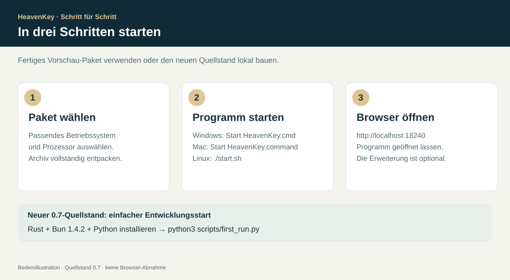
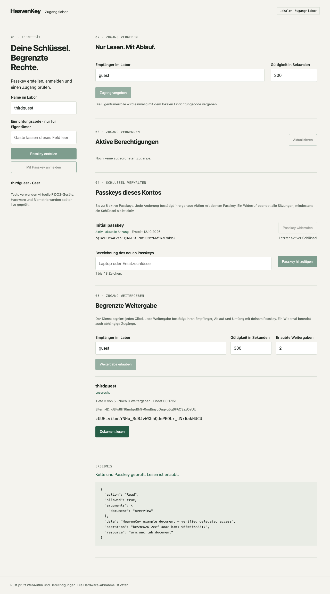
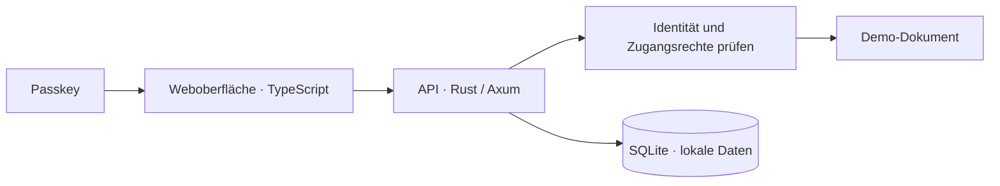

<div align="center">

# HeavenKey

**Zugang beginnt mit Zustimmung.**

Mit Passkeys anmelden, zeitlich begrenzte Zugänge teilen und jede Weitergabe kontrollieren.

[](https://github.com/Supersynergy/HeavenKey/actions/workflows/ci.yml) 

<p align="center">
  
</p>

[Bebilderte Installation](docs/INSTALLATION.md) · [Passkey-Anleitung](docs/PASSKEY-GUIDE.md) · [Agenten](docs/AGENT-GUIDE.md) · [Funktionen](#funktionen) · [Browserdemo](docs/BROWSER-DEMO.md) · [Ausprobieren](#ausprobieren) · [Benutzung](docs/USAGE.md) · [Roadmap](docs/ROADMAP.md)

</div>

## Schnellstart



**Aktueller Quellstand: 0.7.0, lokale Vorschau.** Die veröffentlichten 0.6-Pakete enthalten die neuen Funktionen noch nicht. Die [bebilderte Installationsanleitung](docs/INSTALLATION.md) erklärt beide Wege und die Erweiterungen für Chrome, Edge und Firefox.

Nach Installation von Rustup, Bun **1.4.2** und Python 3.11+ im Projektordner starten:

```sh
python3 scripts/first_run.py
```

Windows: `py -3 scripts/first_run.py`. Der Assistent baut und öffnet HeavenKey; `just` und Docker sind dafür nicht nötig. Neue vorkompilierte 0.7-Pakete für alle Plattformen und die Browser-/Hardware-Abnahme sind noch offen.

## Funktionen

| Funktion | Was du damit machen kannst |
| --- | --- |
| Mit Passkey anmelden | Ein Konto über WebAuthn erstellen und dich mit einem aktiven Passkey anmelden. |
| Mehrere Passkeys verwalten | Bis zu acht aktive Passkeys verwalten, mit Namen und individuellem Widerruf. Der letzte aktive Schlüssel bleibt geschützt. |
| Zugang teilen | Einem registrierten Gast Leserechte auf das Demo-Dokument geben, gültig für 1–3.600 Sekunden. |
| Weitergabe begrenzen | Festlegen, ob und wie oft ein Gast seinen Zugang weitergeben darf: bis zu vier Weitergaben, höchstens fünf Kettenglieder. |
| Rechte eingrenzen | Nachfolger erhalten höchstens die Rechte und Laufzeit ihres Elternzugangs. |
| Zugang entziehen | Einen Zugang widerrufen und damit auch seine abhängigen Nachfolger sperren. |
| Änderungen bestätigen | Die Details einer Änderung vor der frischen Passkey-Bestätigung prüfen. |
| Zustände behalten | Den Kontozustand lokal speichern; ein Neustart hebt Sperren nicht auf. |
| Einfach lesen | Innerhalb einer aktiven Sitzung mit laufend geprüften Berechtigungen lesen; sensible Änderungen weiterhin frisch bestätigen. |
| Konto wiederherstellen | Gesicherten Einmalcode verbrauchen, neuen Passkey erstellen und alte Schlüssel, Sitzungen und Agenten sperren. |
| Signierschlüssel schützen | Schlüssel verschlüsselt speichern; Schutzschlüssel im Betriebssystem-Keystore oder in einer expliziten externen Datei verwahren. |
| Agenten begrenzen | Eigene Maschinenschlüssel, genaue Rechte, Laufzeiten, Schlüsselbesitznachweis und Widerruf; ausführbarer lokaler CRM-Pilot mit synthetischen Daten. |
| Privaten Tresor nutzen | Optional mit PRF-fähigem Passkey lokal entschlüsseln, mehrere Passkeys berechtigen und unabhängigen Offline-Schlüssel sichern. |
| Browser-Erweiterung öffnen | Direkt zu Passkeys, Freigaben, Recovery, Agenten, Tresor und Hilfe; in Chrome, Edge oder Firefox. |

### Ein Beispiel

Du gibst Anna für 30 Minuten Zugang und erlaubst eine Weitergabe. Anna kann Ben Zugang für zehn Minuten geben. Ben kann ihn nicht weitergeben. Widerrufst du Annas Zugang, endet auch Bens Zugriff. Vor der Nutzung prüft HeavenKey die aktuelle Berechtigungskette.



## Ausprobieren

Die neue [Browserdemo](docs/BROWSER-DEMO.md) zeigt Teilen, Öffnen und Widerrufen mit Beispieldaten. Sie braucht keine Anmeldung oder Installation. Im aktuellen Quellstand liegt sie unter `/demo/`; der Ordner `apps/demo` funktioniert auch direkt im Browser. Die veröffentlichten 0.6-Pakete enthalten diesen neuen Einstieg noch nicht.

Fertige Pakete für **Windows x64, macOS ARM64/Intel und Linux ARM64/x64** stehen in den [Vorschau-Releases](https://github.com/Supersynergy/HeavenKey/releases). Entpacken und den enthaltenen Starter ausführen; ein aktueller Browser genügt. Rust, Bun und Docker brauchst du nur für die Entwicklung. Die [Paket-Anleitung](docs/DISTRIBUTION.md) erklärt Einrichtung, Datenordner und die Erweiterungen für Chrome, Edge und Firefox.

### Aus dem Quellcode bauen

Voraussetzungen: Rustup, Bun **1.4.2**, `just`, Python 3 und Google Chrome. Auf macOS müssen die Xcode Command Line Tools für den nativen Build installiert sein. Die Rust-Version ist in `rust-toolchain.toml` festgelegt. Das private Repository benötigt GitHub-Zugriff.

```sh
git clone https://github.com/Supersynergy/HeavenKey.git
cd HeavenKey
bun install --frozen-lockfile --ignore-scripts
cargo fetch --locked
just build
just e2e
```

`just e2e` testet den vollständigen Ablauf mit virtuellen Passkeys in einem isolierten Chrome-Browser. Browser, Server und Testdaten werden anschließend entfernt. Ein anderer Chrome-Pfad lässt sich mit `CHROME_PATH=/pfad/zu/chrome just e2e` angeben.

Die Oberfläche startest du mit `cargo run --locked --offline -p uac-api -- --open` auf `http://localhost:18240`. Die [Anleitung](docs/USAGE.md) beschreibt Einrichtung, Schlüsselverwaltung und Zugangsteilung.

## Stand und Grenzen

**Version 0.7 ist eine lokale Vorschau im Quellstand.** Verfügbare 0.6-Desktop-Pakete haben den älteren Funktionsumfang. Desktop-Pakete enthalten die Weboberfläche und ihre nativen Bibliotheken. Windows wird zusätzlich über Wine geprüft; das ersetzt keine Abnahme von Windows Hello oder physischen Passkeys. Firefox-Erweiterungen sind vorerst temporär installierbar. Der kostenlose GitHub-Runner läuft lokal; gehostete kostenpflichtige Runner werden nicht verwendet. Neue Prüfungen und offene Browser-/Hardware-Grenzen stehen unter [0.7-Verifikation](docs/V07-VERIFICATION.md); ältere Nachweise unter [Verifikation](docs/VERIFICATION.md).

Die Demo arbeitet mit einem Testdokument. Der Dienst signiert Zugänge und prüft sie online. Recovery, geschützte Signierschlüssel, ein optionaler PRF-Notiztresor und ein lokaler Agenten-/CRM-Adapter sind implementiert. Vollständige Datenbankverschlüsselung, echte Mandanten, reale externe Integrationen und Offline-Nutzung bleiben gesonderte Vorhaben. Das Delegationsprofil ist ein eigenes Format; UCAN-/DID-Kompatibilität ist noch offen.

## Aufbau



Der Passkey bestätigt dein Konto und die konkrete Aktion. Ein signierter Zugang bestimmt, welche Ressource du nutzen darfst und wie lange. Die API prüft beides vor der Ausführung.

## Dokumentation

- [Bebilderte Installation](docs/INSTALLATION.md)
- [Passkeys, Recovery und Tresor](docs/PASSKEY-GUIDE.md)
- [Agentenprogramm und CRM-Pilot](docs/AGENT-GUIDE.md)
- [Implementierung, APIs und Grenzen](docs/PASSKEY-PLATFORM.md)
- [Benutzung: Einrichten, teilen und widerrufen](docs/USAGE.md)
- [Neu in 0.5: begrenzte Weitergabe](docs/V05-RESULT.md)
- [Roadmap und Zeitplanung](docs/ROADMAP.md)
- [Entwicklung und Tests](docs/DEVELOPMENT.md)
- [API- und Sicherheitsverhalten](docs/SPEC.md)
- [Delegationsformat](docs/DELEGATION-CONTRACT.md)
- [Abhängigkeiten und Lizenzen](docs/DONORS.md)
- [Änderungen](CHANGELOG.md)

## Mitwirken und Rechte

[Beiträge](CONTRIBUTING.md) · [Sicherheitsmeldungen](SECURITY.md) · [Lizenzhinweise](NOTICE.md)

HeavenKey ist ein privates Supersynergy-Projekt mit vorbehaltenen Rechten. Eine Open-Source-Lizenz wurde nicht vergeben. Abhängigkeiten behalten ihre Lizenzen.
