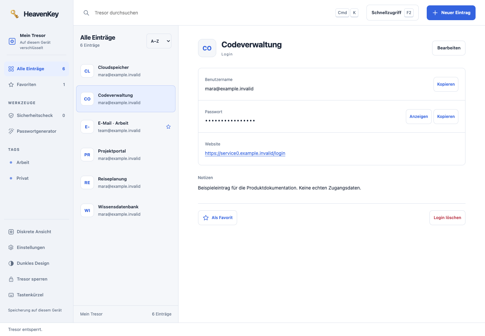

# HeavenKey

**Zugang beginnt mit Zustimmung.**


Passwörter und Formularprofile lokal verwalten. HeavenKey verschlüsselt den Tresor im Browser und speichert ihn auf deinem Computer. Für den Passwortmanager brauchst du weder ein Cloudkonto noch eine Internetverbindung.

[](https://github.com/Supersynergy/HeavenKey/actions/workflows/ci.yml) [](https://github.com/Supersynergy/HeavenKey/releases/tag/v0.17.0-rc.1)

[Downloads](https://github.com/Supersynergy/HeavenKey/releases/tag/v0.17.0-rc.1) · [Einrichtung](docs/DISTRIBUTION.md) · [Bedienung](docs/PASSWORD-MANAGER.md) · [Dateitransfer](docs/TRANSFER-BROKER.md) · [Abnahme](docs/PASSWORD-MANAGER-VERIFICATION.md) · [Lizenz](LICENSE)



*Die Bilder zeigen die echte lokale App mit ausschließlich erfundenen Beispieldaten. Passwörter bleiben verdeckt.*

## Die Idee hinter HeavenKey

Deine digitalen Türen sollen unter deiner Kontrolle bleiben. Der lokale Tresor bewahrt Passwörter und Formularprofile auf. Beim Ausfüllen entscheidest du, welche Angaben auf welche Seite gelangen. Browser-Verbindungen kannst du im Tresor widerrufen.

Die ursprüngliche Idee steckt jetzt im Passwortmanager: den lokalen Tresor mit einem Passkey entsperren und einzelne Angaben zeitlich begrenzt an einen Empfänger weitergeben. Du wählst die Felder, die Laufzeit und kannst die Freigabe widerrufen. Das getrennte [Zugangslabor](#passkey-zugangslabor) bleibt für weitergehende Experimente erhalten. HeavenKey ist kein Passkey-Anbieter für beliebige Websites. Das Titelbild ist das ursprüngliche Markenmotiv, keine Aufnahme einer Funktion.

## Starten

1. Lade das Paket für deinen Computer aus dem [aktuellen Release](https://github.com/Supersynergy/HeavenKey/releases/tag/v0.17.0-rc.1). Prüfe es mit der dortigen `SHA256SUMS` und entpacke es.
2. Öffne den enthaltenen Starter. Er startet den lokalen Dienst und öffnet `http://localhost:18240/passwords/` im Browser.
3. Lege ein Masterpasswort mit mindestens 14 Zeichen fest. Exportiere anschließend eine verschlüsselte Sicherung und prüfe ihre Wiederherstellung.

| Computer | Paket | Starter |
| --- | --- | --- |
| macOS mit Apple Silicon | `HeavenKey-0.17.0-macos-arm64.zip` | `Start HeavenKey.command` |
| macOS mit Intel-Prozessor | `HeavenKey-0.17.0-macos-x64.zip` | `Start HeavenKey.command` |
| Linux x64 | `HeavenKey-0.17.0-linux-x64.tar.gz` | `./start.sh` |
| Linux ARM64 | `HeavenKey-0.17.0-linux-arm64.tar.gz` | `./start.sh` |

Der neue Transfer-Broker wird für macOS und Linux ausgeliefert. Für Windows steht weiterhin die [vorherige Ausgabe 0.15](https://github.com/Supersynergy/HeavenKey/releases/tag/v0.15.0-rc.1) bereit; eine native Windows-Abnahme des neuen Brokers fehlt.

Für den Tresor genügt ein aktueller Browser. Die optionale Agenten-Sandbox benötigt zusätzlich Docker; Rust und Bun werden nur für die Entwicklung benötigt. Das Terminal des Starters bleibt geöffnet; `Ctrl+C` beendet den Dienst. Die Pakete sind unsigniert und nicht Apple-notarisiert. [Installation und Datenordner](docs/DISTRIBUTION.md) erklären die Betriebssystemhinweise und den Updateablauf.

## Im Alltag

- **Logins:** anlegen und bearbeiten, nach Titel oder Kontodaten suchen, mit Tags ordnen und als Favoriten markieren. Der Generator erstellt zufällige Passwörter; TOTP-Codes werden lokal berechnet.
- **Schnellzugriff:** F2 öffnet die Suche nach Logins und Formularprofilen. F1 zeigt die Tastenkürzel mit einzelnen Tastenkappen.
- **Formularprofile:** Kontakt- und Adressangaben im selben verschlüsselten Tresor speichern. Die Erweiterung zeigt die erkannten Felder vor dem Ausfüllen zur Auswahl.
- **Importvorschau:** eine CSV lokal einlesen und neue, identische oder abweichende Einträge prüfen. Identische Duplikate werden zunächst übersprungen; einen Konflikt ersetzt du ausdrücklich.
- **Sicherungen:** den verschlüsselten Tresor exportieren und mit seinem Masterpasswort wiederherstellen. Profile bleiben bei Login-Änderungen und Passwortwechseln erhalten.
- **Diskrete Ansicht:** private Detailfelder verdecken; bei Bedarf sofort beim Wechsel in den Hintergrund sperren. Ein lokaler Check zeigt kurze oder wiederverwendete Passwörter, ohne einen Datenleckdienst anzufragen.
- **Passkey-Entsperren:** unter Einstellungen einen PRF-fähigen Passkey hinzufügen, benennen und den bestehenden Tresor damit öffnen. Das Masterpasswort bleibt für Sicherungen, Wiederherstellung und den Rückweg erforderlich.
- **Befristete Freigaben:** einzelne Login- oder Profilfelder ausdrücklich auswählen und als verschlüsselte Kopie für fünf Minuten bis sieben Tage freigeben. Der erste Empfänger bindet seinen eigenen Passkey an die Freigabe. Weitere Abrufe erfordern denselben Passkey.
- **Agent-Zugriff:** pro Anmeldung einen Login und die genaue Website freigeben. Der lokale Broker nutzt einen eigenen Browser ohne Zwischenablage; Agenten erhalten eine begrenzte Textansicht. [Einrichtung und Schutzgrenze](docs/AGENT-BROKER.md).
- **Dateitransfer:** SFTP-/FTPES-Profile und eigene Ed25519-Schlüssel verschlüsselt verwalten. Jede Agentenaktion benötigt Zustimmung; Downloads legen Dateiinhalt offen, Uploads binden Ziel und Hash. Zehn Client-Übergaben und zehn Anbieterprofile einschließlich netcup erleichtern die Einrichtung. Ein serverseitig beschränktes Transferkonto bleibt Voraussetzung. [Anleitung und Grenzen](docs/TRANSFER-BROKER.md).
- **SSH-Schlüsselspeicher:** Ed25519-Identitäten einmal erzeugen oder als PKCS8-/Public-Key-Paar importieren und für mehrere SFTP-Verbindungen verwenden. Die Paarprüfung und Duplikatprüfung laufen vor dem Speichern. Eine Verbindungsvorschau übernimmt geprüfte Angaben erst nach Bestätigung. [Formate, Sicherung und Grenzen](docs/SSH-KEYS.md).
- **Erste Schritte:** der Einrichtungsassistent führt zu erstem Login, Import, Sicherung und optionalem Passkey. Vorhandene Sicherungen lassen sich direkt vom Sperrbildschirm wiederherstellen.

Ohne zusätzliche Konfiguration funktionieren Freigabelinks nur auf demselben Computer. Für andere Geräte braucht der laufende Dienst eine erreichbare HTTPS-Adresse mit `HEAVENKEY_SHARE_ORIGIN` und einen korrekt eingerichteten Reverse-Proxy. Die Oberfläche weist vor der Erstellung darauf hin. [Einrichtung und Sicherheitsgrenzen](docs/ACCESS-AND-SHARING.md) erklären Empfängerbindung, Widerruf und Betrieb.

### Ausfüllen im Browser

Installiere das separate Chromium-Paket für Chrome oder Edge. Erzeuge unter Einstellungen einen einmaligen Kopplungscode und gib ihn mit dem lokalen Port in der Erweiterung ein. Der Dienst muss laufen. Die [Installationsanleitung](docs/DISTRIBUTION.md#browser-erweiterung) beschreibt auch das temporäre Laden unter Firefox ab Version 140.

Zum Füllen wählst du einen Login oder ein Profil, prüfst die Zielseite und bestätigst die ausgewählten Felder. Logins benötigen genau die gespeicherte Website-Origin. Finanz- und Identitätsdaten sowie Passwörter und Einmalcodes haben eigene Freigaben. Bestehende Werte bleiben standardmäßig erhalten; Formulare werden nicht abgesendet. Rückgängig ist für die unveränderte Zielseite zeitlich begrenzt möglich.

Die Erweiterung hat keinen dauerhaften Zugriff auf alle Websites. Der Browser speichert nur Verbindungseinstellungen und das Kopplungstoken. Sperren, Trennen oder Schließen entfernt die entschlüsselte Sitzung. Eine bereits an die Seite übergebene Eingabe kann diese wie eine manuelle Eingabe lesen.

### Anmeldung für einen Agenten

Unter Einstellungen koppeln, die Anfrage prüfen und einen passenden Login ausdrücklich auswählen. Die Sitzung endet nach höchstens fünf Minuten; Sperren und Widerruf beenden den Zugriff. Der Broker bietet keine rohe Browser-API. Shell-Agenten können über den [eingeschlossenen Startweg](docs/AGENT-SANDBOX.md) ohne Host-Dateien, Netzwerk und Clienttoken arbeiten. Ein zusätzlicher freier Host-Zugang würde diesen Schutz umgehen. Zielwebsite, Host und Administrator gehören zur Vertrauensgrenze. Er benötigt installiertes Chrome, Chromium oder Edge; der normale Tresor bleibt offline nutzbar.

Die OS-Sandbox-Erweiterung ist ein Release-Kandidat. Linux-Kernel-Isolation und native Windows-Abnahme werden im Releasebericht getrennt ausgewiesen; ein Wine-Test ersetzt keine Windows-Sicherheitsprüfung.


## Ansichten


<details>
<summary>Schnellzugriff, Formularprofil und schmale Ansicht</summary>


</details>

[Herkunft der Bilder](docs/screenshots/README.md)

## Sicherheit und Grenzen

Das Masterpasswort und der nicht exportierbare Schlüssel bleiben im entsperrten Browser. Der Dienst speichert die verschlüsselte Tresorhülle mit AES-256-GCM; neue Tresore verwenden Argon2id mit 64 MiB Speicher, drei Durchläufen und einer Lane. Bestehende PBKDF2-HMAC-SHA256-Tresore mit 600.000 Iterationen bleiben lesbar. Unter „Masterpasswort ändern“ kannst du sie nach einer Sicherung bewusst neu verschlüsseln; dabei werden Passkeys und Freigaben widerrufen. Alte Sicherungen bleiben im alten Format. Revisionen verhindern stilles Überschreiben aus veralteten Tabs. Der lokale Dienst bindet an Loopback und prüft Host, Origin und sein Prozess- beziehungsweise Kopplungstoken. Details stehen in der [Passwortmanager-Anleitung](docs/PASSWORD-MANAGER.md).

Verlust des Masterpassworts lässt sich nicht durch HeavenKey zurücksetzen. Ein Passkey hilft nur, solange sein verschlüsselter lokaler Umschlag und das Gerät verfügbar sind. Ein Passwortwechsel oder eine gesperrte Wiederherstellung entfernt Passkey-Umschläge und widerruft bestehende Freigaben. Bereits abgerufene Angaben kann ein Empfänger speichern; Ablauf und Widerruf verhindern weitere Serverabrufe. Der vollständige Freigabelink ist vertraulich: Wer ihn zuerst mit einem Passkey beansprucht, wird zum gebundenen Empfänger. JavaScript garantiert keine vollständige physische Speicherlöschung; die Bereinigung der Zwischenablage hängt vom Browser ab. Programme im selben Benutzerkonto und ein kompromittierter Browser gehören zur Vertrauensgrenze.

Die [Release-Abnahme](docs/PASSWORD-MANAGER-VERIFICATION.md) unterscheidet natives Apple Silicon von Rosetta, Wine und QEMU. Die Chromium-Tests verwenden eine ausdrückliche Testfreigabe für localhost; der native Berechtigungsdialog ist nicht automatisiert abgenommen. Firefox wurde auf Paketebene geprüft. Physische Passkeys und ein externes Kryptografie-Audit sind nicht abgenommen. Native mobile Apps, Gerätesynchronisation und die Verwaltung von Website-Passkeys sind noch offen. Die responsive Ansicht ersetzt keinen mobilen Credential-Provider.

`ACCEPTANCE.json` und `SHA256SUMS` im jeweiligen Release binden die Nachweise an Quellstand und Dateien. Der [Vergleich mit Enpass und 20 weiteren Produkten](docs/PASSWORD-MANAGER-GAPS.md) dokumentiert den früheren Ausgangsstand; er ist kein aktuelles Gesamtranking oder Nachweis eines allgemeinen Funktionsvorsprungs.

## Passkey-Zugangslabor

Im selben Produkt ist das getrennte Zugangslabor enthalten: WebAuthn-Anmeldung, mehrere Passkeys und Recovery sowie zeitlich begrenzte Freigaben mit kontrollierter Weitergabe. Dazu kommen ein optionaler PRF-Notiztresor und begrenzte Agentenrechte. Es verwendet eigene Daten und Schutzschlüssel. Der experimentelle Grant-Codec ist kein UCAN-Interoperabilitätsnachweis.

```sh
./heavenkey --password-manager --open
./heavenkey --port 18241 --open
```

Die erste Zeile startet den Passwortmanager, die zweite das Zugangslabor. Unter Windows heißt das Programm `HeavenKey.exe`.

[Passkey-Anleitung](docs/PASSKEY-GUIDE.md) · [Zugänge und Recovery](docs/USAGE.md) · [Agenten](docs/AGENT-GUIDE.md) · [Integration](docs/INTEGRATION.md)

## Entwicklung

Voraussetzungen: Rustup mit dem in `rust-toolchain.toml` festgelegten Toolchain, Bun **1.4.2**, Python 3 und `just`. Browserprüfungen benötigen Chrome oder einen passenden `CHROME_PATH`; native Builds benötigen die jeweiligen Plattformwerkzeuge.

```sh
git clone https://github.com/Supersynergy/HeavenKey.git
cd HeavenKey
bun install --frozen-lockfile --ignore-scripts
cargo fetch --locked
just build
just check
just e2e
```

Der [Startassistent](scripts/first_run.py) baut den Passwortmanager mit `python3 scripts/first_run.py`; `--lab` startet das Zugangslabor. Verwende in Tests ausschließlich synthetische Daten. Das private Repository benötigt eine Zugriffsberechtigung.

[Entwicklung](docs/DEVELOPMENT.md) · [API und Sicherheitsverhalten](docs/SPEC.md) · [Änderungen](CHANGELOG.md) · [Sicherheitsmeldungen](SECURITY.md)

## Lizenz und Rechte

HeavenKey ist proprietäre Software. Die [HeavenKey Proprietary License 1.0](LICENSE) erlaubt berechtigten Empfängern offizieller Binärpakete persönliche und interne Nutzung. Weitervertrieb, öffentliche Forks und abgeleitete Produkte benötigen eine gesonderte Erlaubnis. Drittanbieter-Lizenzen und zwingende gesetzliche Rechte bleiben erhalten.

[Einordnung der Lizenz](docs/LICENSING.md) · [Drittanbieterhinweise](NOTICE.md) · [Beiträge](CONTRIBUTING.md)
