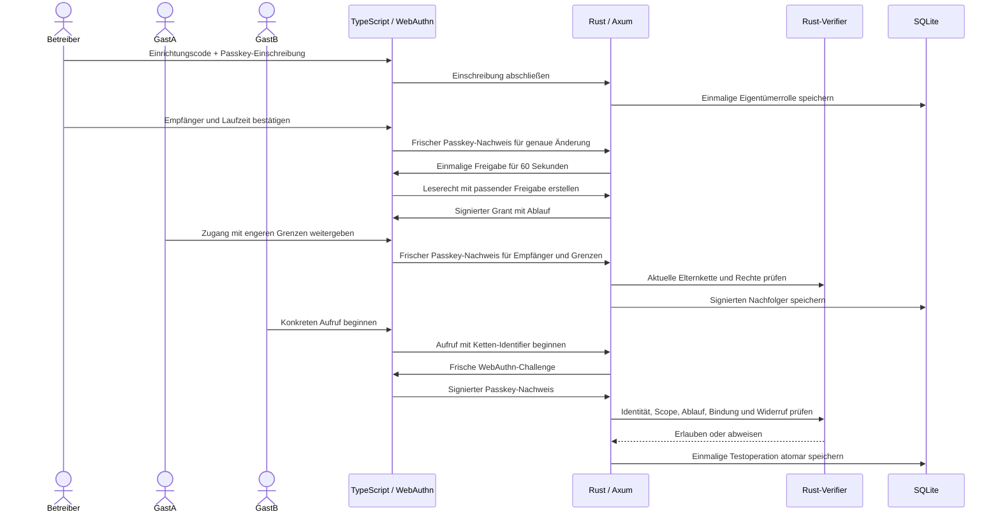

<div align="center">

# HeavenKey

**Zugang beginnt mit Zustimmung.**

Passkeys und begrenzte Zugangsrechte für Entwickler, die Autorisierung bis zur Ausführung prüfen wollen. Rust verifiziert Identität und Rechte; TypeScript führt durch Einschreibung und Zugriff.

[](https://github.com/Supersynergy/HeavenKey/actions/workflows/ci.yml)


<p align="center">
  
</p>

[Quick start](#quick-start) · [Architektur](#architektur) · [Nachweise](#nachweise) · [Roadmap](docs/ROADMAP.md)

</div>

## Was heute funktioniert

| Funktion | Verhalten |
| --- | --- |
| Kontrollierte Einrichtung | Ein lokaler Einrichtungscode und eine erfolgreiche Passkey-Einschreibung vergeben einmalig die Eigentümerrolle. Ein früher Gast erhält diese Rolle nicht. |
| Passkey-Anmeldung | Rust prüft Origin, RP, Challenge, Signatur und User Verification über `webauthn-rs`. |
| Begrenzter Zugang | Signiertes Leserecht für eine Testressource mit einer Gültigkeit von 1–3.600 Sekunden. |
| Gebundener Aufruf | Ein frischer Passkey-Nachweis bestätigt die genaue Operation einschließlich ihrer Argumente. |
| Begrenzte Weitergabe | Ein Gast gibt Zugang mit frischer Passkey-Zustimmung weiter. Rechte, Laufzeit und Weitergabegrenze bleiben innerhalb der Elternvorgabe; maximal fünf Kettenglieder. |
| Widerruf der Kette | Ein widerrufener Vorfahr sperrt seine Nachfolger und offene Aufrufe. Der Server prüft die aktuelle Kette bis zur Ausführung. |
| Bestätigte Änderungen | Passkeys und Zugänge ändern sich erst nach einer frischen, serverseitig geprüften Freigabe für genau diese Aktion. Die Freigabe gilt 60 Sekunden und einmal. |
| Mehrere Passkeys | Bis zu acht aktive Schlüssel pro Konto. Hinzufügen und Widerruf sind an die konkrete Zustimmung gebunden; der letzte Schlüssel bleibt geschützt. |
| Widerruf und Neustart | Der Server prüft Widerruf vor der Ausführung; Credentials und Widerrufe bleiben in SQLite. Offene Dialoge und Sitzungen werden beim Neustart ungültig. |

**Stand: Forschungsprototyp 0.5.** Tests verwenden virtuelle CTAP2-Geräte im echten Chrome-Browser und den echten Rust-Verifier. Das Profil `heavenkey-delegation-v1` wird vom Dienst signiert und verlangt online die Zustimmung des berechtigten Kontos. Kontokennungen sind keine DIDs oder Signierschlüssel. UCAN-Interoperabilität, Wallets und physische Geräte sind noch offen.

## Quick start

Voraussetzungen: Rustup, Bun **1.4.2**, `just`, Python 3 und Google Chrome. Rustup lädt die festgelegte Nightly-Version. Die Simulation ist auf macOS geprüft; Linux-Pfade und Ubuntu-CI sind vorbereitet, aber noch nicht ausgeführt. Das private Repository setzt GitHub-Zugriff voraus.

```sh
git clone https://github.com/Supersynergy/HeavenKey.git
cd HeavenKey
bun install --frozen-lockfile --ignore-scripts
cargo fetch --locked
just build
just e2e
```

Die lokale Browser-Abnahme für 0.5 besteht **138/138 Fälle**: sämtliche 96 bisherigen Prüfungen und 42 neue Delegationsfälle. Dazu kommen **45 Rust-Tests** und **75 Prüfungen der unabhängigen Node-Referenz**. Der [Ausbaubericht](docs/V05-RESULT.md) hält Prüfabläufe und Grenzen fest.

Der Quick Start wurde aus einem frischen GitHub-Clone von Source-Commit `4916bda` geprüft: 28 Datei-Hashes identisch, gelockte Installation, leeres Build-Verzeichnis und **138/138 Browserfälle bestanden**. Auch die Referenzprüfung besteht im Clone. Der Durchlauf dauerte hier rund 31 Sekunden mit warmem Paket-Registry-Cache; daraus folgt kein Vergleich der Entwicklungsgeschwindigkeit.

Der Test startet einen isolierten Browser und einen lokalen Server und beendet beide danach. Er verwendet kein persönliches Browserprofil. Testdaten und virtuelle Schlüssel werden gelöscht. Ein anderer Chrome-Pfad lässt sich mit `CHROME_PATH=/pfad/zu/chrome just e2e` angeben.

Für `just check` werden außerdem `cargo-nextest` **0.9.146**, `cargo-deny` **0.20.2** und `cargo-audit` **0.22.2** benötigt. Die vollständige Prüfung umfasst Formatierung, TypeScript, Clippy, Rust-Tests, Lizenz-/Quellenregeln, Advisories und Build. CI führt den portablen Source- und Browser-Testablauf aus; er enthält keine Deployment-Schritte.

GitHub-CI wurde vor Ausführung eines Schritts durch eine Zahlungs-/Ausgabenlimit-Sperre des Accounts abgewiesen. Der [CI-Fix und seine Prüfbelege](docs/CI-REPAIR.md) ergänzen frische Artefakte sowie Rust-Sicherheitsprüfungen und trennen lokale Abnahme von der noch offenen Ubuntu-Ausführung.

## Späterer Live-Test

```sh
just dev
```

Öffne `http://localhost:18240`. Der Server erzeugt `data/owner-bootstrap.txt` mit einem zufälligen Einrichtungscode, unter Unix nur für den Betreiber lesbar. Lies ihn in einem zweiten Terminal mit `cat data/owner-bootstrap.txt` und trage ihn bei der Eigentümer-Einschreibung ein. Gäste lassen das Feld leer. Nach erfolgreicher Eigentümer-Einschreibung kann der Code keine weitere Eigentümerrolle vergeben.

Der Server läuft im Vordergrund und endet spätestens nach zwei Stunden. Daten bleiben lokal unter `data/` und sind von Git ausgeschlossen. Verwende für den späteren Test ein frisches Datenverzeichnis: Alte Eigentümer aus dem ursprünglichen Spike bleiben erhalten und werden dadurch nicht nachträglich als vertrauenswürdig provisioniert bestätigt.

## Architektur



```text
apps/api/          Rust-API, WebAuthn und persistente Zustände
apps/web/          TypeScript-Oberfläche ohne UI-Framework
crates/verifier/   Signaturen und Berechtigungsregeln
scripts/          Browser-Simulation und begrenzte Ausführung
docs/             Vertrag, Roadmap, Reviews und Nachweise
```

Der Passkey beweist die Identität; der separate Grant begrenzt die erlaubte Aktion. Das API verwendet einen Prozess und lokales SQLite. Die zugrunde liegende Testoperation liest ein künstliches Dokument.

Der Dienst signiert jedes Glied des Delegationsprofils mit Ed25519. Rust und die unabhängige Referenz prüfen festgelegte Signierbytes und Identifier. Beide implementieren das HeavenKey-Profil; daraus folgt keine Kompatibilität mit fremden UCAN-/DID-Implementierungen. Die älteren direkten Grants bleiben separat verwendbar.

## Nachweise

Die [Browser-Ergebnisse](docs/evidence/e2e.json) zeigen jeden ausgeführten Fall: fremde Empfänger, manipulierte Rechte, falsche Origin/RP/Challenge, fehlende User Verification, Signaturfehler, Counter-Rücksprung, Replay, parallele Duplikate, Ablauf, Widerruf und Neustart. Der Ausbau prüft zusätzlich die Eigentümer-Einrichtung sowie einmalige Aktionsfreigaben und einen tatsächlich abgebrochenen Passkey-Dialog mit erfolgreichem Neuversuch.


- [Ausbau 0.5 und aktuelle Nachweise](docs/V05-RESULT.md)
- [Delegationsvertrag und unabhängiger Review](docs/DELEGATION-REVIEW.md)
- [Öffentliche synthetische Testvektoren](docs/vectors/delegation-v1.json)
- [Ausbau 0.4: Einmalige Aktionsfreigaben](docs/V04-RESULT.md)
- [Vertrag und unabhängiger Review der Aktionsfreigaben](docs/STEPUP-REVIEW.md)
- [Ausbau 0.3: Mehrere Schlüssel und quadratisches Titelbild](docs/V03-RESULT.md)
- [Enpass-Prinzipien und konkrete Code-Donoren](docs/DONORS.md)
- [Verhaltensvertrag](docs/SPEC.md)
- [Roadmap und Gesamtschätzung](docs/ROADMAP.md)
- [Aktueller Source-Review](docs/REVIEW.md)
- [Spike-Ergebnis](docs/SPIKE-RESULT.md)
- [Metacode, Efficiency Orchestrator und zehn ausgewählte Skills](docs/DEVELOPMENT.md)
- [Änderungen](CHANGELOG.md)

Offen sind reale Hardware, Recovery, Mandanten, Schlüsselrotation, verteilte Ausführung, sichere Offline-Zeit und Kompatibilität mit fremden Protokollen. Ein getrenntes Offline-Ziel kennt einen neuen entfernten Widerruf erst nach Empfang entsprechender Information.

Bestehende Zugänge gehören in diesem Profil zum Konto. Ein widerrufener Passkey kann sich nicht mehr anmelden; ein anderer aktiver Schlüssel desselben Kontos kann den Zugang weiter verwenden. Zum Entziehen des Zugangs wird der Grant widerrufen.

Die Aktion ist serverseitig an die WebAuthn-Challenge gebunden. WebAuthn liefert hier keine vertrauenswürdige Anzeige der Transaktionsdaten auf dem Authentikator; ein kompromittierter Browser bleibt eine offene Vertrauensgrenze.

## Mitwirken, Sicherheit und Rechte

Änderungen brauchen überprüfbares Verhalten und passende Prüfungen: [CONTRIBUTING.md](CONTRIBUTING.md). Sicherheitsprobleme werden privat gemeldet: [SECURITY.md](SECURITY.md).

HeavenKey ist ein privates Supersynergy-Projekt mit vorbehaltenen Rechten. Eine Open-Source-Lizenz wurde nicht vergeben. Abhängigkeiten behalten ihre Lizenzen; Hinweise stehen in [NOTICE.md](NOTICE.md) und der [Bildherkunft](docs/assets/README.md).
