# HeavenKey

**Zugang beginnt mit Zustimmung.**


Passwörter auf dem Desktop und auf Android lokal verwalten. HeavenKey verschlüsselt den Tresor auf deinem Gerät. Desktop und Handy lassen sich ausdrücklich koppeln und manuell abgleichen; Android erstellt und verwendet Website-Passkeys. Für den Passwortmanager brauchst du kein Cloudkonto.

[](https://github.com/Supersynergy/HeavenKey/actions/workflows/ci.yml) [](https://github.com/Supersynergy/HeavenKey/releases/tag/v0.26.0-preview.1)

[Alle aktuellen Downloads](https://github.com/Supersynergy/HeavenKey/releases/tag/v0.26.0-preview.1) · [Desktop einrichten](docs/DISTRIBUTION.md) · [Handy und Synchronisierung](docs/MOBILE-SYNC-PASSKEYS.md) · [Bedienung](docs/PASSWORD-MANAGER.md) · [Lizenz](LICENSE)

Android 0.27.0 hat einen eigenen [Produktions-Release-Ablauf](docs/ANDROID-PRODUCTION.md)
für die eigenständige Handy-Nutzung. Der Ablauf veröffentlicht erst nach nativen
Wiederherstellungstests und Prüfung der konfigurierten Herausgebersignatur.

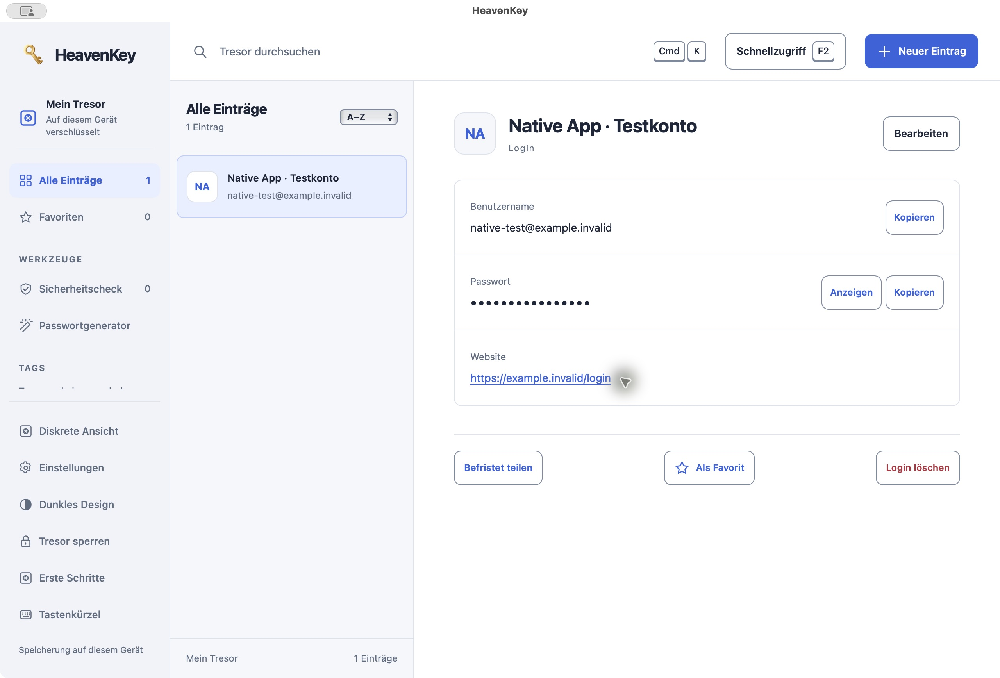

*Die Bilder zeigen die echte lokale App mit ausschließlich erfundenen Beispieldaten. Passwörter bleiben verdeckt.*

Die macOS-App hat ein eigenes Fenster, native Datei-Dialoge und Tastaturmenüs. Beim Beenden stoppt sie ihren Dienst und die daran gebundenen Agentensitzungen. Passkeys hängen von WebView, Betriebssystem und Authenticator ab; über „Ansicht → Im Browser öffnen“ kannst du einen kompatiblen Browser verwenden.

## Beim ersten Start

Erstelle einen Tresor oder wähle die Wiederherstellung deiner Sicherung. Der erste Login braucht Website, Nutzername und das aktuelle Passwort; der Name lässt sich aus der Domain übernehmen. Android zeigt zunächst nur drei Login-Felder; eigene Namen und Notizen sind optional. Ein eigener Passkey-Tab, wählbare Generatorlängen und ein neues Hell-/Dunkel-Design erleichtern den Einstieg. Der unveröffentlichte Android-Quellstand ergänzt zudem V2-Sicherungen einschließlich Website-Passkeys ohne Desktop; die verlinkte 0.26-APK enthält diese Änderungen noch nicht. Android akzeptiert auch eine vollständige HTTPS-Adresse und zeigt vor dem Speichern die genaue Herkunft ohne Pfad.

Ein neues Passwort erzeugst du ausdrücklich. Bereits eingegebene Passwörter werden erst nach Bestätigung ersetzt. Vorschläge für Nutzernamen stammen aus dem entsperrten lokalen Tresor. Nach dem ersten Login führen passende Aktionen zur Sicherung, Browserintegration und Gerätekopplung. [Einstieg und Grenzen](docs/ONBOARDING.md).

## Die Idee hinter HeavenKey

Deine digitalen Türen sollen unter deiner Kontrolle bleiben. Der lokale Tresor bewahrt Passwörter und Formularprofile auf. Beim Ausfüllen entscheidest du, welche Angaben auf welche Seite gelangen. Browser-Verbindungen kannst du im Tresor widerrufen.

Die ursprüngliche Idee steckt jetzt im Passwortmanager: den lokalen Tresor mit einem Passkey entsperren und einzelne Angaben zeitlich begrenzt an einen Empfänger weitergeben. Du wählst die Felder, die Laufzeit und kannst die Freigabe widerrufen. Android bietet zusätzlich Website-Passkeys über den geprüften Standardbrowser an; der Desktop verwahrt synchronisierte Passkeys im verschlüsselten Tresor. Ein Desktop-Betriebssystemanbieter ist noch nicht enthalten. Das getrennte [Zugangslabor](#passkey-zugangslabor) bleibt für weitergehende Experimente erhalten. Das Titelbild ist das ursprüngliche Markenmotiv, keine Aufnahme einer Funktion.

## Starten

1. Lade das Paket aus dem [gemeinsamen Release 0.26](https://github.com/Supersynergy/HeavenKey/releases/tag/v0.26.0-preview.1). Prüfe es mit der dortigen `SHA256SUMS` und entpacke Desktop-Pakete vollständig. Die Android-APK wird auf dem Handy installiert.
2. Öffne auf macOS `HeavenKey.app`. Die App verwaltet ihren lokalen Dienst und zeigt den Tresor im eigenen Fenster. Unter Windows und Linux öffnet der Starter den lokalen Tresor im Browser.
3. Desktop: Lege ein Masterpasswort mit mindestens 14 Zeichen fest. Android: Bestätige deine Gerätesperre; ein zusätzliches Masterpasswort ist nicht erforderlich. Exportiere anschließend eine verschlüsselte Sicherung und prüfe ihre Wiederherstellung.

| System | Paket | Starter |
| --- | --- | --- |
| macOS mit Apple Silicon | [HeavenKey-0.26.0-macos-arm64.zip](https://github.com/Supersynergy/HeavenKey/releases/download/v0.26.0-preview.1/HeavenKey-0.26.0-macos-arm64.zip) | `HeavenKey.app` (macOS 14+) |
| macOS mit Intel-Prozessor | [HeavenKey-0.26.0-macos-x64.zip](https://github.com/Supersynergy/HeavenKey/releases/download/v0.26.0-preview.1/HeavenKey-0.26.0-macos-x64.zip) | `HeavenKey.app` (macOS 14+) |
| Windows x64 | [HeavenKey-0.26.0-windows-x64.zip](https://github.com/Supersynergy/HeavenKey/releases/download/v0.26.0-preview.1/HeavenKey-0.26.0-windows-x64.zip) | `Start HeavenKey.cmd` |
| Linux x64 | [HeavenKey-0.26.0-linux-x64.tar.gz](https://github.com/Supersynergy/HeavenKey/releases/download/v0.26.0-preview.1/HeavenKey-0.26.0-linux-x64.tar.gz) | `./start.sh` |
| Linux ARM64 | [HeavenKey-0.26.0-linux-arm64.tar.gz](https://github.com/Supersynergy/HeavenKey/releases/download/v0.26.0-preview.1/HeavenKey-0.26.0-linux-arm64.tar.gz) | `./start.sh` |
| Android | [HeavenKey-0.26.0-android-preview.apk](https://github.com/Supersynergy/HeavenKey/releases/download/v0.26.0-preview.1/HeavenKey-0.26.0-android-preview.apk) | Android 11+, Gerätesperre; Website-Passkeys ab Android 14 |

[Chromium-Erweiterung](https://github.com/Supersynergy/HeavenKey/releases/download/v0.26.0-preview.1/HeavenKey-0.26.0-extension-chromium.zip) · [Firefox-Erweiterung](https://github.com/Supersynergy/HeavenKey/releases/download/v0.26.0-preview.1/HeavenKey-0.26.0-extension-firefox.zip) · [SHA256SUMS](https://github.com/Supersynergy/HeavenKey/releases/download/v0.26.0-preview.1/SHA256SUMS)

Alle acht Pakete liegen im selben Release. Android enthält den vereinfachten Einstieg der Version 0.26. Ein iOS-Paket ist noch nicht verfügbar. Dies ist eine Entwicklungsvorschau; Herausgebersignaturen und Produktionsfreigabe stehen aus.

Windows verwendet jetzt denselben OpenSSL-Pfad für SSH-Schlüssel im Speicher wie macOS und Linux. Wine-Kompatibilität und echte Windows-Sicherheitsabnahme sind getrennte Nachweise. Die Pakete sind noch ohne Herausgebersignatur oder Notarisierung.

Für den Tresor genügt ein aktueller Browser. Die optionale Agenten-Sandbox benötigt zusätzlich Docker; Rust und Bun werden nur für die Entwicklung benötigt. Das Terminal des Starters bleibt geöffnet; `Ctrl+C` beendet den Dienst. Die Pakete sind unsigniert und nicht Apple-notarisiert. [Installation und Datenordner](docs/DISTRIBUTION.md) erklären die Betriebssystemhinweise und den Updateablauf.

## Im Alltag

- **Logins:** anlegen und bearbeiten, nach Titel oder Kontodaten suchen, mit Tags ordnen und als Favoriten markieren. Der Generator erstellt zufällige Passwörter; TOTP-Codes werden lokal berechnet.
- **Schnellzugriff:** F2 öffnet die Suche nach Logins und Formularprofilen. F1 zeigt die Tastenkürzel mit einzelnen Tastenkappen.
- **Formularprofile:** Kontakt- und Adressangaben im selben verschlüsselten Tresor speichern. Die Erweiterung zeigt die erkannten Felder vor dem Ausfüllen zur Auswahl.
- **Importvorschau:** eine CSV lokal einlesen und neue, identische oder abweichende Einträge prüfen. Identische Duplikate werden zunächst übersprungen; einen Konflikt ersetzt du ausdrücklich.
- **Sicherungen:** den verschlüsselten Tresor exportieren und mit seinem Masterpasswort wiederherstellen. Profile bleiben bei Login-Änderungen und Passwortwechseln erhalten.
- **Diskrete Ansicht:** private Detailfelder verdecken; bei Bedarf sofort beim Wechsel in den Hintergrund sperren. Ein lokaler Check zeigt kurze oder wiederverwendete Passwörter, ohne einen Datenleckdienst anzufragen.
- **Passkey-Entsperren:** unter Einstellungen einen PRF-fähigen Passkey hinzufügen, benennen und den bestehenden Tresor damit öffnen. Das Masterpasswort bleibt für Sicherungen, Wiederherstellung und den Rückweg erforderlich.
- **Handy und Desktop:** mit einem einmaligen Code koppeln und Logins sowie Website-Passkeys über gepinntes TLS verschlüsselt abgleichen. Änderungen werden manuell synchronisiert; Konflikte brauchen eine ausdrückliche Auswahl. [Einrichtung und Sicherung](docs/MOBILE-SYNC-PASSKEYS.md).
- **Befristete Freigaben:** einzelne Login- oder Profilfelder ausdrücklich auswählen und als verschlüsselte Kopie für fünf Minuten bis sieben Tage freigeben. Der erste Empfänger bindet seinen eigenen Passkey an die Freigabe. Weitere Abrufe erfordern denselben Passkey.
- **Geschützte Entwürfe:** Person, E-Mail und Vorgang verschlüsselt speichern; vorhandene lokale Profile übernehmen und einen eigenen Agenten nur mit Platzhaltern arbeiten lassen. Gebundene Anmeldungen einzeln bestätigen, ohne Seitenansicht oder Zwischenablage. Den Text lokal prüfen und nach einem eigenen Klick einmal an einen festgelegten Website-Endpunkt senden. Der geschützte Agent sieht weder Klartext noch Website- oder Versandresultat. [Ablauf und Grenzen](docs/PROTECTED-FLOW.md).
- **Agent-Zugriff:** pro Anmeldung einen Login und die genaue Website freigeben. Der lokale Broker nutzt einen eigenen Browser ohne Zwischenablage; Agenten erhalten eine begrenzte Textansicht. [Einrichtung und Schutzgrenze](docs/AGENT-BROKER.md).
- **Dateitransfer:** SFTP-/FTPES-Profile und eigene Ed25519-Schlüssel verschlüsselt verwalten. Jede Agentenaktion benötigt Zustimmung; Downloads legen Dateiinhalt offen, Uploads binden Ziel und Hash. Zehn Client-Übergaben und zehn Anbieterprofile einschließlich netcup erleichtern die Einrichtung. Ein serverseitig beschränktes Transferkonto bleibt Voraussetzung. [Anleitung und Grenzen](docs/TRANSFER-BROKER.md).
- **SSH-Schlüsselspeicher:** Ed25519-Identitäten einmal erzeugen oder als PKCS8-/Public-Key-Paar importieren und für mehrere SFTP-Verbindungen verwenden. Die Paarprüfung und Duplikatprüfung laufen vor dem Speichern. Eine Verbindungsvorschau übernimmt geprüfte Angaben erst nach Bestätigung. [Formate, Sicherung und Grenzen](docs/SSH-KEYS.md).
- **Erste Schritte:** der Einrichtungsassistent führt zu erstem Login, Import, Sicherung und optionalem Passkey. Vorhandene Sicherungen lassen sich direkt vom Sperrbildschirm wiederherstellen.

Ohne zusätzliche Konfiguration funktionieren Freigabelinks nur auf demselben Computer. Für andere Geräte braucht der laufende Dienst eine erreichbare HTTPS-Adresse mit `HEAVENKEY_SHARE_ORIGIN` und einen korrekt eingerichteten Reverse-Proxy. Die Oberfläche weist vor der Erstellung darauf hin. [Einrichtung und Sicherheitsgrenzen](docs/ACCESS-AND-SHARING.md) erklären Empfängerbindung, Widerruf und Betrieb.

### Ausfüllen im Browser

Installiere das separate Chromium-Paket für Chrome oder Edge. Unter Firefox ab Version 140 kannst du das Firefox-Paket temporär laden; eine dauerhafte Firefox-Signierung steht aus. Erzeuge unter Einstellungen einen einmaligen Kopplungscode und gib ihn mit dem lokalen Port in der Erweiterung ein. Der Dienst muss laufen. Details stehen in der [Installationsanleitung](docs/DISTRIBUTION.md#browser-erweiterung).

Per Rechtsklick öffnest du „Login sicher einfügen“ oder wählst eine gespeicherte Formularvorlage. Passende Logins stehen oben. Bei einem eindeutigen Loginformular wählt HeavenKey die leeren Anmeldefelder vor; du bestätigst die genaue Adresse vor dem Einfügen. „Neues Passwort“, unsichtbare Felder und fremde Frames bleiben ausgeschlossen. Es wird nichts abgesendet.

Entsperre mit dem Masterpasswort oder einem zuvor eingerichteten PRF-Passkey. Der Passkey-Weg öffnet die lokale HeavenKey-Seite: Vergleichscode prüfen, mit dem Gerät bestätigen und in der Erweiterung die Freigabe übernehmen. Fingerabdruck, Gesicht, PIN oder Sicherheitsschlüssel hängen vom Gerät und Browser ab. Die einmalige verschlüsselte Übergabe läuft nach 90 Sekunden ab. Das Masterpasswort bleibt der Rückweg.

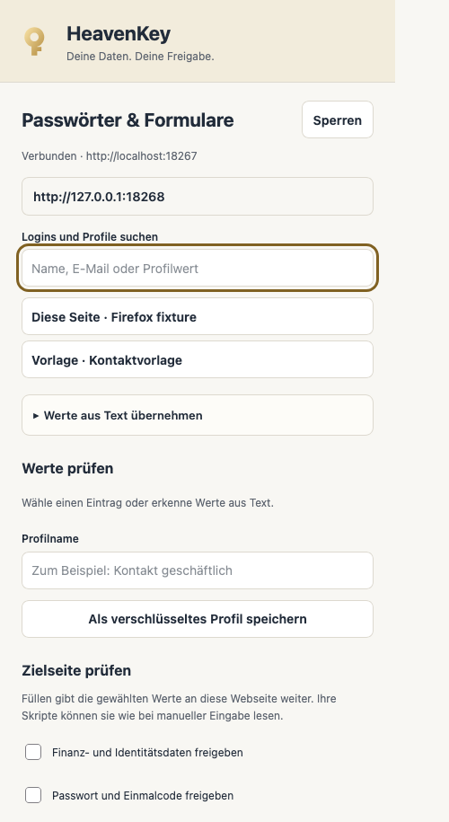

Browser-Abnahme mit synthetischen Testdaten.

Die Erweiterung hat keinen dauerhaften Zugriff auf alle Websites. Der Browser speichert nur Verbindungseinstellungen und das Kopplungstoken. Sperren, Trennen oder Schließen entfernt die entschlüsselte Sitzung. Eine bereits an die Seite übergebene Eingabe kann diese wie eine manuelle Eingabe lesen.

### Anmeldung für einen Agenten

Unter Einstellungen koppeln, die Anfrage prüfen und einen passenden Login ausdrücklich auswählen. Die Sitzung endet nach höchstens fünf Minuten; Sperren und Widerruf beenden den Zugriff. Der Broker bietet keine rohe Browser-API. Shell-Agenten können über den [eingeschlossenen Startweg](docs/AGENT-SANDBOX.md) ohne Host-Dateien, Netzwerk und Clienttoken arbeiten. Ein zusätzlicher freier Host-Zugang würde diesen Schutz umgehen. Zielwebsite, Host und Administrator gehören zur Vertrauensgrenze. Er benötigt installiertes Chrome, Chromium oder Edge; der normale Tresor bleibt offline nutzbar.

Die OS-Sandbox-Erweiterung ist ein Release-Kandidat. Linux-Kernel-Isolation und native Windows-Abnahme werden im Releasebericht getrennt ausgewiesen; ein Wine-Test ersetzt keine Windows-Sicherheitsprüfung.

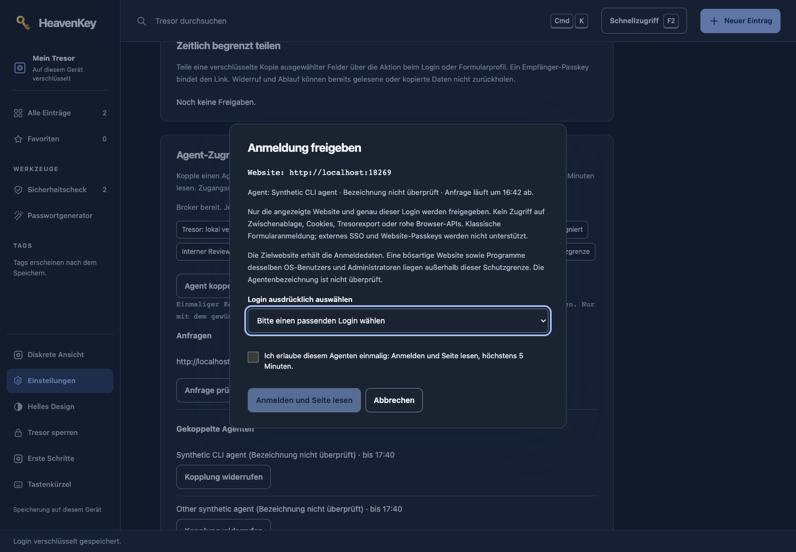

Geschützte Aufträge übernehmen auf Wunsch ein lokales Formularprofil. Einmalige Zustellung benötigt ein vorher gebundenes Website-Ziel und deine Prüfung des Textes. [Schutzgrenze und Restrisiken](docs/PROTECTED-THREAT-MODEL.md).

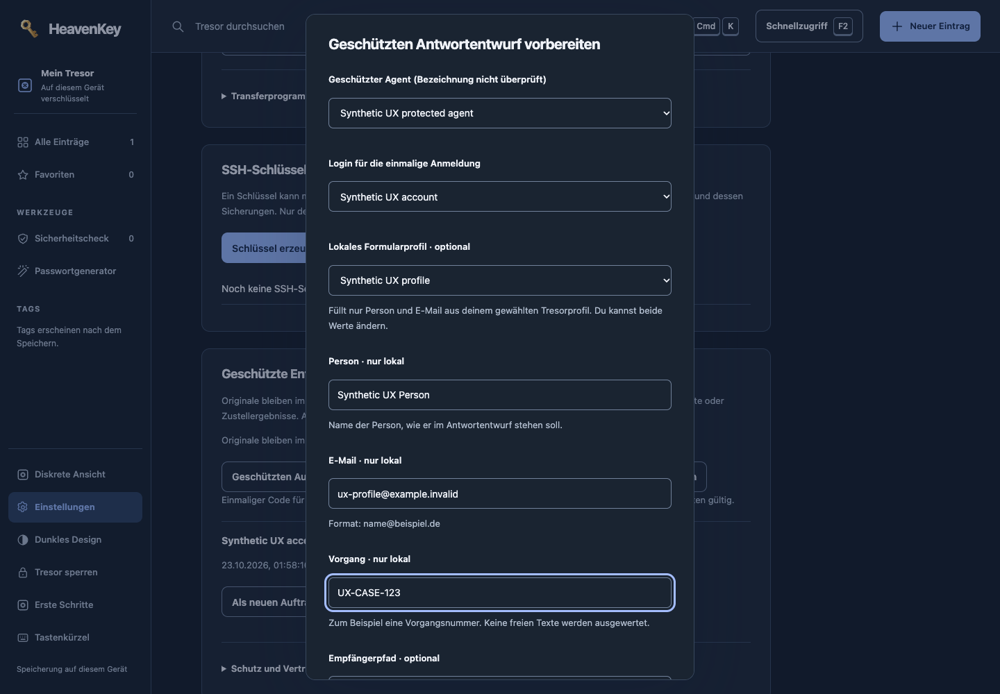

## Ansichten

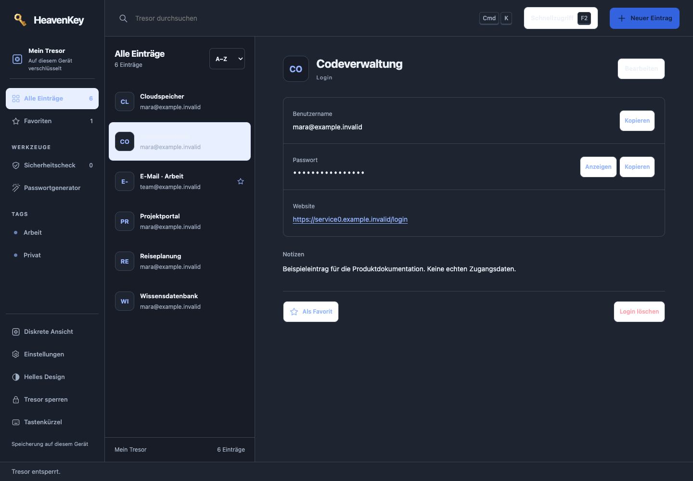

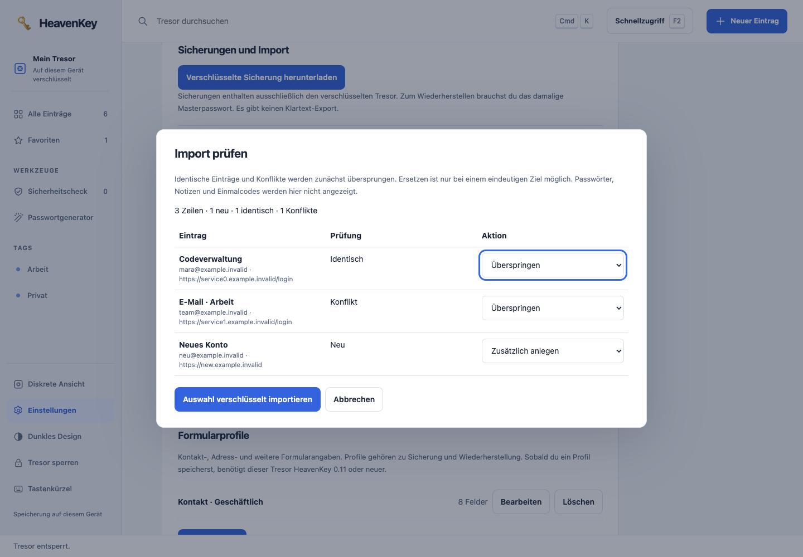

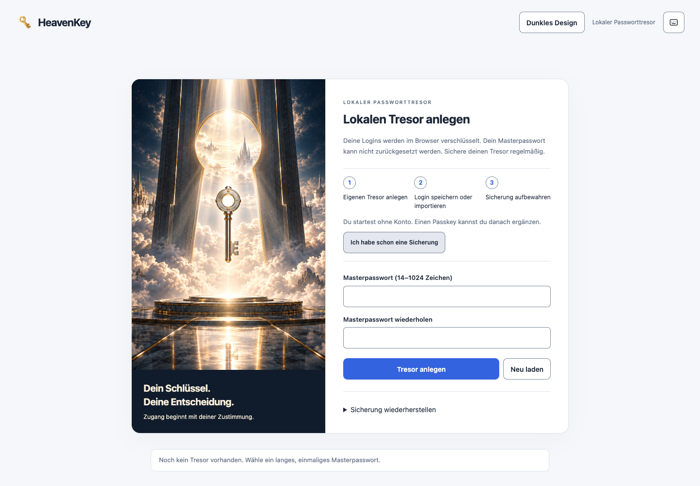

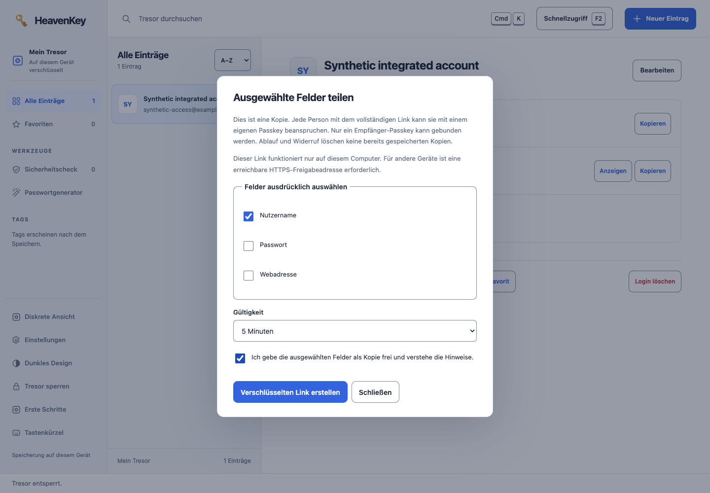

<details>
<summary>Schnellzugriff, Formularprofil und schmale Ansicht</summary>

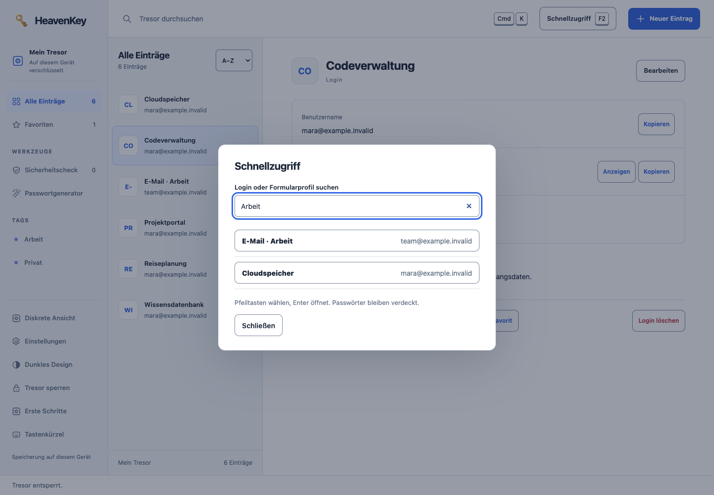

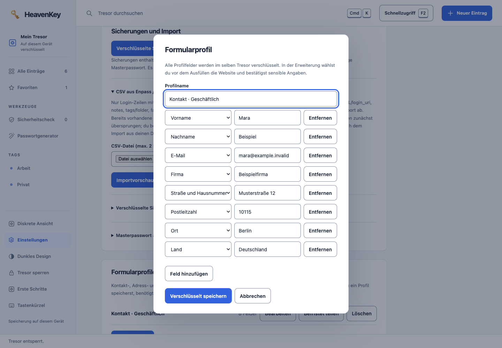

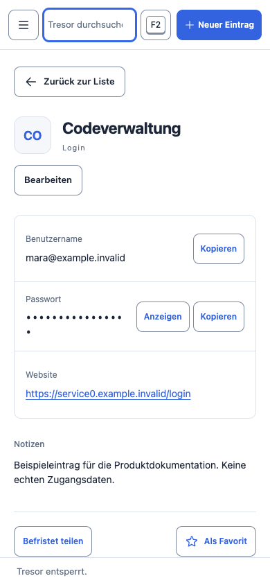

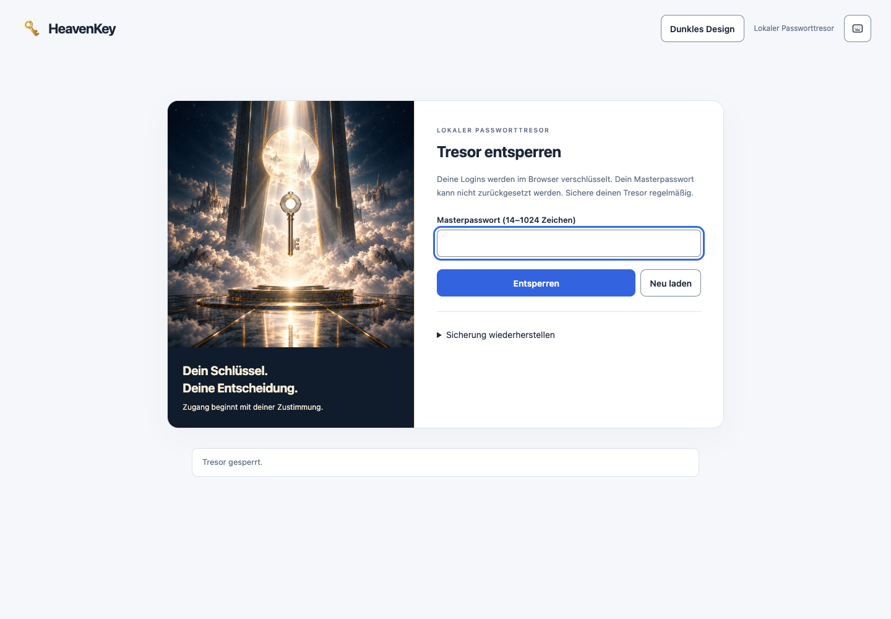

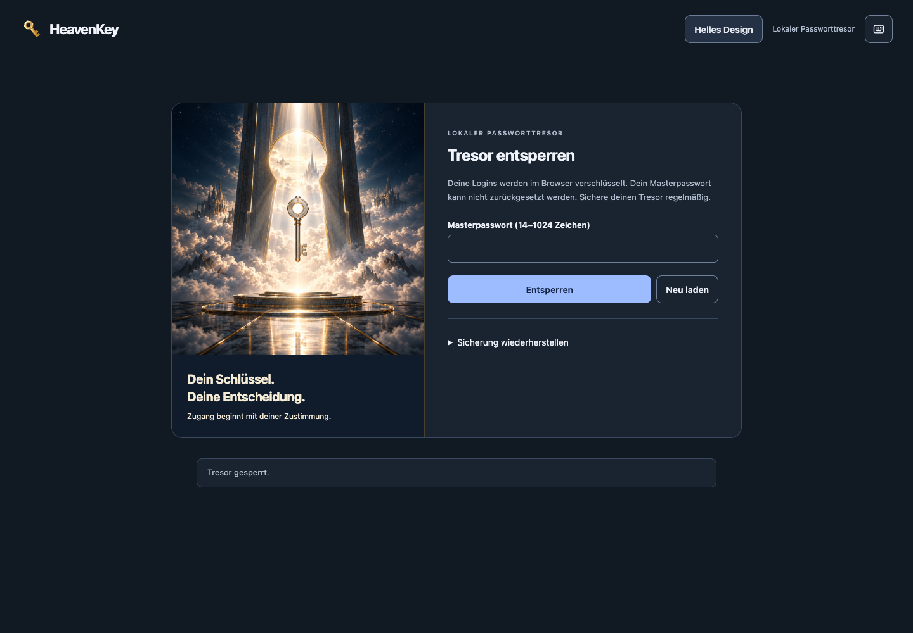

</details>

[Herkunft der Bilder](docs/screenshots/README.md)

## Sicherheit und Grenzen

Das Masterpasswort und der nicht exportierbare Schlüssel bleiben im entsperrten Browser. Der Dienst speichert die verschlüsselte Tresorhülle mit AES-256-GCM; neue Tresore verwenden Argon2id mit 64 MiB Speicher, drei Durchläufen und einer Lane. Bestehende PBKDF2-HMAC-SHA256-Tresore mit 600.000 Iterationen bleiben lesbar. Unter „Masterpasswort ändern“ kannst du sie nach einer Sicherung bewusst neu verschlüsseln; dabei werden Passkeys und Freigaben widerrufen. Alte Sicherungen bleiben im alten Format. Revisionen verhindern stilles Überschreiben aus veralteten Tabs. Die normale Desktop-Oberfläche bindet an Loopback und prüft Host, Origin und ihr Prozess- beziehungsweise Kopplungstoken. Erst eine ausdrückliche Handy-Kopplung öffnet den separaten TLS-Sync-Port im Netzwerk. Details stehen in der [Passwortmanager-Anleitung](docs/PASSWORD-MANAGER.md).

Verlust des Masterpassworts lässt sich nicht durch HeavenKey zurücksetzen. Ein Passkey hilft nur, solange sein verschlüsselter lokaler Umschlag und das Gerät verfügbar sind. Ein Passwortwechsel oder eine gesperrte Wiederherstellung entfernt Passkey-Umschläge und widerruft bestehende Freigaben. Bereits abgerufene Angaben kann ein Empfänger speichern; Ablauf und Widerruf verhindern weitere Serverabrufe. Der vollständige Freigabelink ist vertraulich: Wer ihn zuerst mit einem Passkey beansprucht, wird zum gebundenen Empfänger. JavaScript garantiert keine vollständige physische Speicherlöschung; die Bereinigung der Zwischenablage hängt vom Browser ab. Programme im selben Benutzerkonto und ein kompromittierter Browser gehören zur Vertrauensgrenze.

Die [Release-Abnahme](docs/RELEASE-0.26.md) unterscheidet natives Apple Silicon von Rosetta, Wine und QEMU. Die Chromium-Tests verwenden eine ausdrückliche Testfreigabe für localhost; der native Berechtigungsdialog der Desktop-Erweiterung ist nicht automatisiert abgenommen. Firefox wurde auf Paketebene geprüft. Android-Synchronisierung und Website-Passkeys sind auf einem API-36-Emulator mit Brave 1.98.60 geprüft; Nachweise stehen im [mobilen Prüfstand](docs/MOBILE-ACCEPTANCE.md). Physische Telefone, iOS und ein externes Kryptografie-Audit bleiben gesonderte Abnahmen. Die Produktionsfreigabe steht aus.

`ACCEPTANCE.json` und `SHA256SUMS` im jeweiligen Release binden die Nachweise an Quellstand und Dateien. Der [Vergleich mit Enpass und 20 weiteren Produkten](docs/PASSWORD-MANAGER-GAPS.md) dokumentiert den früheren Ausgangsstand; er ist kein aktuelles Gesamtranking oder Nachweis eines allgemeinen Funktionsvorsprungs.

## Passkey-Zugangslabor

Im selben Produkt ist das getrennte Zugangslabor enthalten: WebAuthn-Anmeldung, mehrere Passkeys und Recovery sowie zeitlich begrenzte Freigaben mit kontrollierter Weitergabe. Dazu kommen ein optionaler PRF-Notiztresor und begrenzte Agentenrechte. Es verwendet eigene Daten und Schutzschlüssel. Der experimentelle Grant-Codec ist kein UCAN-Interoperabilitätsnachweis.

```sh
./heavenkey --password-manager --open
./heavenkey --port 18241 --open
```

Die erste Zeile startet den Passwortmanager, die zweite das Zugangslabor. Unter Windows heißt das Programm `HeavenKey.exe`.

[Passkey-Anleitung](docs/PASSKEY-GUIDE.md) · [Zugänge und Recovery](docs/USAGE.md) · [Agenten](docs/AGENT-GUIDE.md) · [Integration](docs/INTEGRATION.md)

## Entwicklung

Voraussetzungen: Rustup mit dem in `rust-toolchain.toml` festgelegten Toolchain, Bun **1.4.2**, Python 3 und `just`. Browserprüfungen benötigen Chrome oder einen passenden `CHROME_PATH`; native Builds benötigen die jeweiligen Plattformwerkzeuge.

```sh
git clone https://github.com/Supersynergy/HeavenKey.git
cd HeavenKey
bun install --frozen-lockfile --ignore-scripts
cargo fetch --locked
just build
just check
just e2e
```

Der [Startassistent](scripts/first_run.py) baut den Passwortmanager mit `python3 scripts/first_run.py`; `--lab` startet das Zugangslabor. Verwende in Tests ausschließlich synthetische Daten. Das Repository ist öffentlich; die Downloads stehen unter Releases.

Die Binärpakete wurden mit frischen temporären Datenordnern gestartet. Ein vollständiger Quell-Build aus einem neuen Klon ist nicht Teil dieser Paketabnahme.

[Entwicklung](docs/DEVELOPMENT.md) · [API und Sicherheitsverhalten](docs/SPEC.md) · [Änderungen](CHANGELOG.md) · [Sicherheitsmeldungen](SECURITY.md)

## Lizenz und Rechte

HeavenKey ist proprietäre Software. Die [HeavenKey Proprietary License 1.0](LICENSE) erlaubt berechtigten Empfängern offizieller Binärpakete persönliche und interne Nutzung. Weitervertrieb, öffentliche Forks und abgeleitete Produkte benötigen eine gesonderte Erlaubnis. Drittanbieter-Lizenzen und zwingende gesetzliche Rechte bleiben erhalten.

[Einordnung der Lizenz](docs/LICENSING.md) · [Drittanbieterhinweise](NOTICE.md) · [Beiträge](CONTRIBUTING.md)

## Handy-App in Entwicklung

Die [Flutter-App für Android und iPhone](docs/MOBILE.md) ergänzt den Desktop-Tresor
mit nativer Geräteauthentifizierung und verschlüsselter Sicherung. Android verlangt
für die gemeldete HTTPS-Domain eine ausdrückliche Einmalfreigabe vor dem Entsperren.
Die [gemeinsame Vorschau 0.26](https://github.com/Supersynergy/HeavenKey/releases/tag/v0.26.0-preview.1)
enthält die Android-APK und alle aktuellen Desktop- und Erweiterungspakete.
Android unterstützt den gekoppelten Desktop-Abgleich sowie Website-Passkeys über
den geprüften Standardbrowser. Die APK verwendet einen Debug-Schlüssel; iOS und
physische Telefone stehen aus. Diese Version ist für Testdaten vorgesehen.
[Einrichtung und Grenzen](docs/MOBILE-SYNC-PASSKEYS.md).

Die [bebilderte Installation](docs/INSTALLATION.md) bleibt ausdrücklich auf
Desktop-Release 0.12.0 bezogen. Das [Zugangslabor](docs/LAB-INSTALLATION.md) hat eine
eigene Einrichtung.
