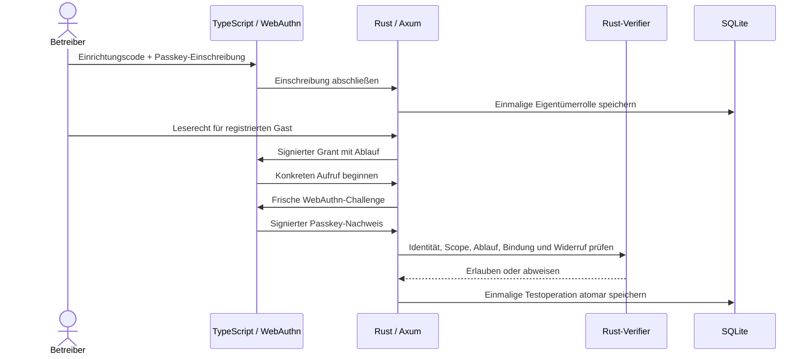
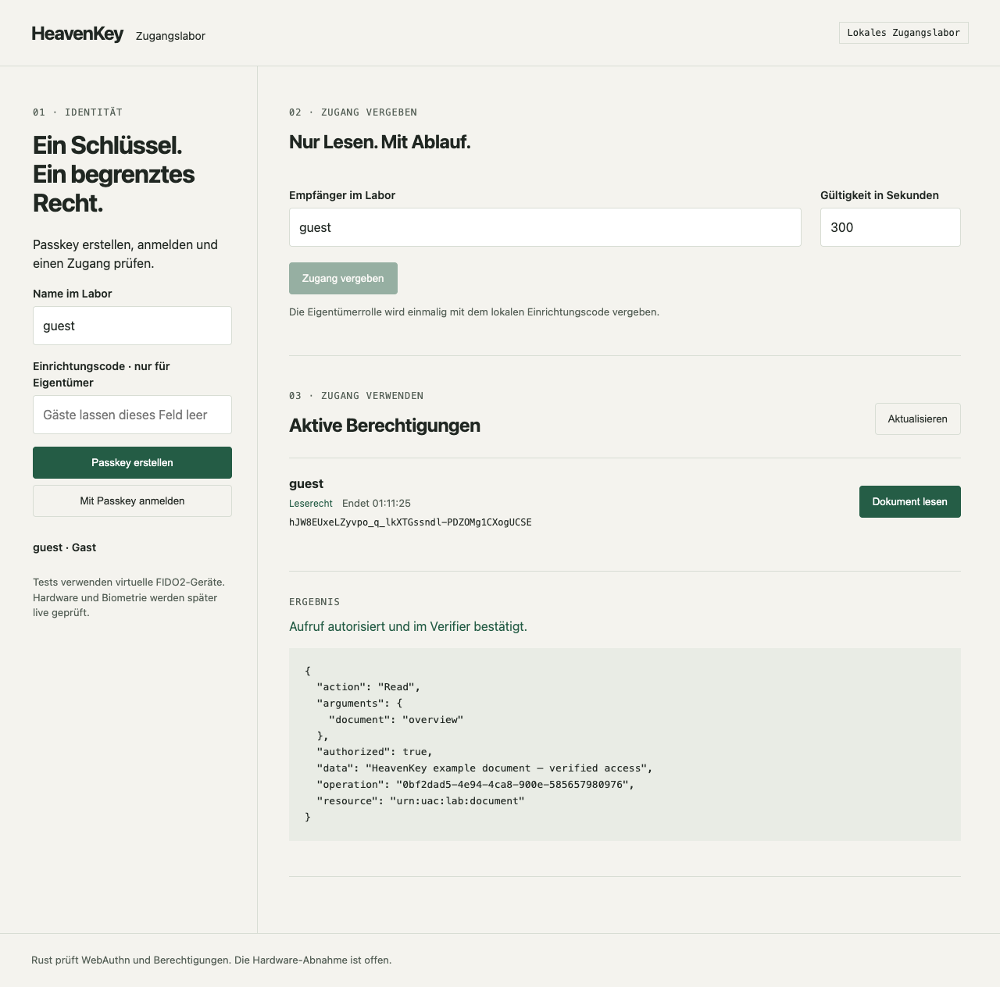

<div align="center">

# HeavenKey

**Zugang beginnt mit Zustimmung.**

Passkeys und begrenzte Zugangsrechte für Entwickler, die Autorisierung bis zur Ausführung prüfen wollen. Rust verifiziert Identität und Rechte; TypeScript führt durch Einschreibung und Zugriff.

[](https://github.com/Supersynergy/HeavenKey/actions/workflows/ci.yml)


[Quick start](#quick-start) · [Architektur](#architektur) · [Nachweise](#nachweise) · [Roadmap](docs/ROADMAP.md)

</div>

## Was heute funktioniert

| Funktion | Verhalten |
| --- | --- |
| Kontrollierte Einrichtung | Ein lokaler Einrichtungscode und eine erfolgreiche Passkey-Einschreibung vergeben einmalig die Eigentümerrolle. Ein früher Gast erhält diese Rolle nicht. |
| Passkey-Anmeldung | Rust prüft Origin, RP, Challenge, Signatur und User Verification über `webauthn-rs`. |
| Begrenzter Zugang | Signiertes Leserecht für eine Testressource mit einer Gültigkeit von 1–3.600 Sekunden. |
| Gebundener Aufruf | Ein frischer Passkey-Nachweis bestätigt die genaue Operation einschließlich ihrer Argumente. |
| Widerruf und Neustart | Der Server prüft Widerruf vor der Ausführung; Credentials und Widerrufe bleiben in SQLite. Offene Dialoge und Sitzungen werden beim Neustart ungültig. |

**Stand: Forschungsprototyp 0.2.** Tests verwenden virtuelle CTAP2-Geräte im echten Chrome-Browser und den echten Rust-Verifier. Touch ID und weitere Geräte werden später live geprüft. Das Grant-Format ist experimentell; UCAN-Interoperabilität, Wallets und physische Geräte sind noch offen.

## Quick start

Voraussetzungen: Rustup, Bun **1.4.2**, `just`, Python 3 und Google Chrome. Rustup lädt die festgelegte Nightly-Version. Die Simulation ist auf macOS geprüft; Linux-Pfade und Ubuntu-CI sind vorbereitet, aber noch nicht ausgeführt. Das private Repository setzt GitHub-Zugriff voraus.

```sh
git clone https://github.com/Supersynergy/HeavenKey.git
cd HeavenKey
bun install --frozen-lockfile --ignore-scripts
cargo fetch --locked
just build
just e2e
```

Der Test startet einen isolierten Browser und einen lokalen Server und beendet beide danach. Er verwendet kein persönliches Browserprofil. Testdaten und virtuelle Schlüssel werden gelöscht. Ein anderer Chrome-Pfad lässt sich mit `CHROME_PATH=/pfad/zu/chrome just e2e` angeben.

Für `just check` werden außerdem `cargo-nextest` **0.9.146**, `cargo-deny` **0.20.2** und `cargo-audit` **0.22.2** benötigt. Die vollständige Prüfung umfasst Formatierung, TypeScript, Clippy, Rust-Tests, Lizenz-/Quellenregeln, Advisories und Build. CI führt den portablen Source- und Browser-Testablauf aus; er enthält keine Deployment-Schritte.

Der erste GitHub-CI-Job wurde vor Ausführung eines Schritts durch eine Zahlungs-/Ausgabenlimit-Sperre des Accounts abgewiesen. Der identische portable Prüfablauf hat lokal bestanden: **41 Browser-Fälle und 24 Rust-Tests**. Die [CI-Diagnose](docs/VERIFICATION.md) hält diese Grenze fest.

## Späterer Live-Test

```sh
just dev
```

Öffne `http://localhost:18240`. Der Server erzeugt `data/owner-bootstrap.txt` mit einem zufälligen Einrichtungscode, unter Unix nur für den Betreiber lesbar. Lies ihn in einem zweiten Terminal mit `cat data/owner-bootstrap.txt` und trage ihn bei der Eigentümer-Einschreibung ein. Gäste lassen das Feld leer. Nach erfolgreicher Eigentümer-Einschreibung kann der Code keine weitere Eigentümerrolle vergeben.

Der Server läuft im Vordergrund und endet spätestens nach zwei Stunden. Daten bleiben lokal unter `data/` und sind von Git ausgeschlossen. Verwende für den späteren Test ein frisches Datenverzeichnis: Alte Eigentümer aus dem ursprünglichen Spike bleiben erhalten und werden dadurch nicht nachträglich als vertrauenswürdig provisioniert bestätigt.

## Architektur



```text
apps/api/          Rust-API, WebAuthn und persistente Zustände
apps/web/          TypeScript-Oberfläche ohne UI-Framework
crates/verifier/   Signaturen und Berechtigungsregeln
scripts/          Browser-Simulation und begrenzte Ausführung
docs/             Vertrag, Roadmap, Reviews und Nachweise
```

Der Passkey beweist die Identität; der separate Grant begrenzt die erlaubte Aktion. Das API verwendet einen Prozess und lokales SQLite. Die zugrunde liegende Testoperation liest ein künstliches Dokument.

## Nachweise

Die [Browser-Ergebnisse](docs/evidence/e2e.json) zeigen jeden ausgeführten Fall: fremde Empfänger, manipulierte Rechte, falsche Origin/RP/Challenge, fehlende User Verification, Signaturfehler, Counter-Rücksprung, Replay, parallele Duplikate, Ablauf, Widerruf und Neustart. Der Ausbau prüft zusätzlich Gast-vor-Eigentümer, falsche Einrichtungscodes und konkurrierende Eigentümer-Einschreibungen.



- [Verhaltensvertrag](docs/SPEC.md)
- [Roadmap und Gesamtschätzung](docs/ROADMAP.md)
- [Aktueller Source-Review](docs/REVIEW.md)
- [Spike-Ergebnis](docs/SPIKE-RESULT.md)
- [Metacode, Efficiency Orchestrator und zehn ausgewählte Skills](docs/DEVELOPMENT.md)
- [Änderungen](CHANGELOG.md)

Offen sind reale Hardware, mehrere Credentials, Recovery, Mandanten, Schlüsselrotation, verteilte Ausführung, sichere Offline-Zeit und ein interoperables Protokoll. Ein getrenntes Offline-Ziel kennt einen neuen entfernten Widerruf erst nach Empfang entsprechender Information.

## Mitwirken, Sicherheit und Rechte

Änderungen brauchen überprüfbares Verhalten und passende Prüfungen: [CONTRIBUTING.md](CONTRIBUTING.md). Sicherheitsprobleme werden privat gemeldet: [SECURITY.md](SECURITY.md).

HeavenKey ist ein privates Supersynergy-Projekt mit vorbehaltenen Rechten. Eine Open-Source-Lizenz wurde nicht vergeben. Abhängigkeiten behalten ihre Lizenzen; Hinweise stehen in [NOTICE.md](NOTICE.md) und der [Bildherkunft](docs/assets/README.md).
