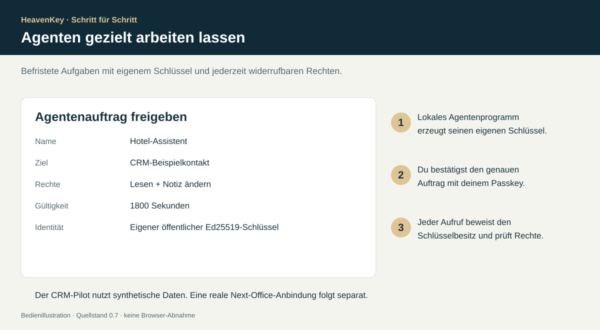

# Agenten mit eigenen, begrenzten Rechten



Der Pilot enthält einen tatsächlich ausführbaren **lokalen CRM-Anschluss mit einem synthetischen Hotelkontakt**. Er ist die Integrationsvorlage für eine spätere Next-Office-Anbindung. Der Agent kann freigegebene Daten lesen oder die Notiz dieses einen Kontakts ändern. Löschen, Exportieren, andere Kontakte oder andere Ressourcen werden abgewiesen.

## 1 · Maschinenschlüssel erzeugen

Node.js 20+ oder Bun verwenden. Der private Schlüssel bleibt in der explizit ausgewählten lokalen Datei; auf Unix wird sie mit Modus 0600 erstellt. Vorhandene Dateien werden nicht überschrieben.

```sh
node scripts/agent.mjs keygen /absoluter/privater/pfad/hotel-agent.pem
```

Das Programm zeigt nur Dateipfad und **öffentlichen** Schlüssel an. Den privaten Schlüssel nicht in HeavenKey eintragen und nicht ins Repository kopieren. Unter Windows einen privaten Benutzerordner mit passenden ACLs verwenden; die native ACL-Abnahme ist offen.

## 2 · Auftrag als Eigentümer freigeben

In HeavenKey anmelden und **„Agentenfreigaben“** öffnen:

- Name: `Hotel-Assistent`
- Öffentlicher Schlüssel: die 43 Zeichen aus Schritt 1
- Ziel: `CRM-Beispielkontakt`
- Rechte: `Lesen` oder `Lesen und Notiz ändern`
- Gültigkeit: beispielsweise `1800` Sekunden
- Elternzugang: leer beim Eigentümer

**„Auftrag mit Passkey freigeben“** wählen, die genauen Parameter prüfen und bestätigen. Die angezeigte Auftrags-ID kopieren.

## 3 · Ausführen

```sh
node scripts/agent.mjs read /absoluter/privater/pfad/hotel-agent.pem AUFTRAGS_ID
node scripts/agent.mjs note /absoluter/privater/pfad/hotel-agent.pem AUFTRAGS_ID Rückruf morgen um 10 Uhr
```

Für eine ausdrücklich konfigurierte HTTPS-Installation `--origin https://deine-heavenkey-domain` ergänzen. Die lokale Vorgabe ist `http://localhost:18240`. Das CLI prüft die Challenge auf Protokollzweck, Server-Origin und die Prüfsumme der angeforderten Aktion, bevor es unterschreibt. Es verwendet keine menschliche Passkey-Sitzung.

Der Server prüft die eigene Signatur des gespeicherten Auftrags, dessen Zeitfenster, aktuellen Widerruf, aktiven autorisierenden Passkey, Resource und Aktion. Dann gibt er eine zufällige Einmal-Challenge aus. Vor der tatsächlichen Änderung wird alles erneut geprüft und der Besitz des Maschinenschlüssels per Ed25519 nachgewiesen. Erfolgreiche Änderungen werden unter derselben Sperre und SQLite-Transaktion atomar ausgeführt. Eine Signatur für eine alte Challenge kann keine zweite Aktion auslösen.

## 4 · Widerrufen

In HeavenKey **„Auftrag widerrufen“** wählen und mit Passkey bestätigen. Offene Challenges dieses Auftrags werden entfernt; künftige Aufrufe scheitern. Eine Kontowiederherstellung widerruft alle Agentenaufträge dieses Kontos. Das Sperren des autorisierenden Passkeys stoppt ebenfalls dessen Aufträge.

## Gäste und Delegation

Ein Gast kann einen Agenten ausschließlich zum Lesen des Demo-Dokuments berechtigen. Dafür benötigt er die ID eines aktuell gültigen, an sein Konto gebundenen Delegationszugangs mit mindestens einer erlaubten Weitergabe. Als Ziel `Demo-Dokument`, als Recht `Lesen` und als Elternzugang diese ID wählen. Die Agentenlaufzeit darf die Restlaufzeit des Elternzugangs nicht überschreiten.

```sh
node scripts/agent.mjs read /absoluter/privater/pfad/hotel-agent.pem AUFTRAGS_ID document
```

Der Elternzugang und sämtliche Vorfahren werden bei jedem Aufruf erneut geprüft. Der Agent erhält keine weitere Delegationsmöglichkeit. Pro Konto sind höchstens 32 gleichzeitig aktive Aufträge möglich; pro Auftrag sind höchstens acht offene Challenges zugelassen.

## Reale Next-Office-Anbindung

Der hier enthaltene Zieladapter verändert nur `crm_contacts` im lokalen Pilot. Eine reale Integration muss dieselbe Prüfung unmittelbar vor dem Connector-Aufruf ausführen und Tenant, Resource, erlaubte Aktion und Parameter serverseitig auf das tatsächliche Ziel abbilden. Für verteilte Ausführung braucht es zusätzlich ein tragfähiges Modell für Transaktionen, Wiederholungen, zeitgleichen Widerruf und externe API-Fehler. Eine reine Prüfung im Browser oder vor dem Einreihen eines langlebigen Workflows reicht dafür nicht aus.
