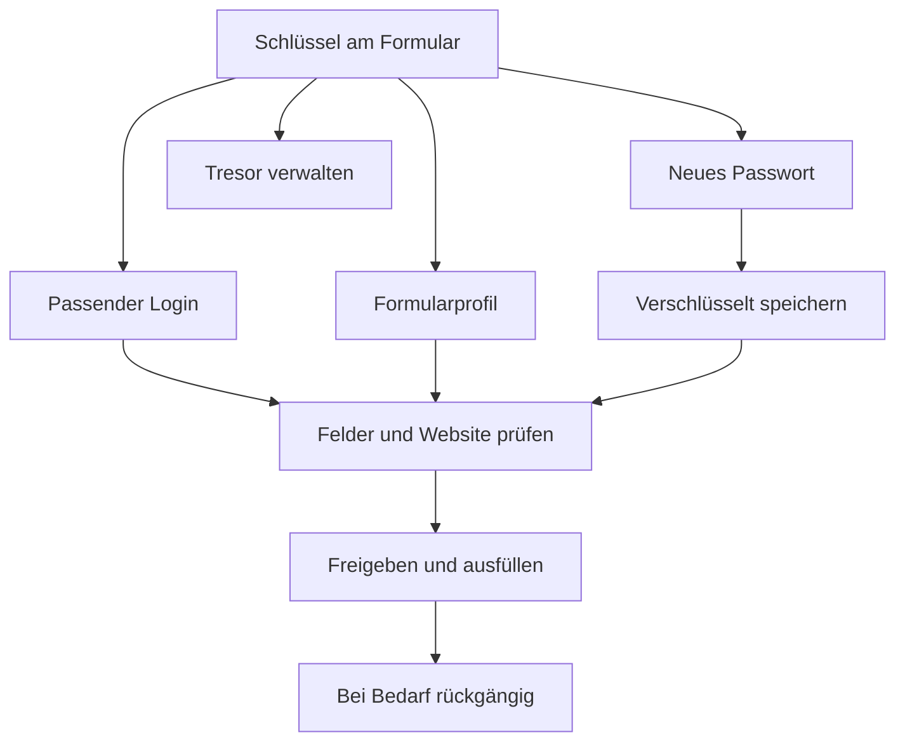

# Formularhilfe: Vergleich von zehn etablierten Passwortmanagern

Stand: 5. November 2026. Auswahl relevanter Referenzprodukte, keine Rangliste nach
Sicherheitsqualität. Aussagen beruhen auf den verlinkten Herstelleranleitungen;
es wurde kein eigener vollständiger Produkttest aller zehn durchgeführt. Die
Funktions- und Prozesskarten sind unsere Verdichtung dieser Anleitungen.

| Referenz und Primärquelle | Funktionskarte für diesen Anwendungsfall | Typischer Prozess | Umsetzung in HeavenKey 0.29 |
| --- | --- | --- | --- |
| [1Password](https://support.1password.com/getting-started-browser/) | Feldmenü → passende Logins → Identitäten → Generator | Feld anklicken → Eintrag oder Generator → ausfüllen | Schlüssel-Menü, genaue Website, Generator im Erweiterungsfenster |
| [Bitwarden](https://bitwarden.com/help/auto-fill-browser/) und [Generator](https://bitwarden.com/help/generator/) | Inline-Menü → Logins/Identitäten → neues Kennwort → Passphrase | Anmeldefeld → auswählen; Registrierung → neues Kennwort erzeugen | Kontenauswahl, Formularprofile, Zufallspasswörter und sechs EFF-Wörter |
| [Proton Pass](https://proton.me/support/pass-browser-extension) und [Autosave](https://proton.me/support/proton-pass-autosave) | Vorschläge → Login/Identität → neue Einträge → Speichern | Registrierung → Vorschlag → Konto anlegen → speichern | Neue Logins im Menü; verschlüsseltes Speichern vor Passwortlieferung |
| [Dashlane](https://support.dashlane.com/hc/en-us/articles/202699151-Autofill-your-data-using-Dashlane) | Feldtyp → passende Personen-/Zahlungsdaten → Kontextmenü | Feld fokussieren → Wert auswählen → Formular ergänzen | Kontextbezogene Profilvorschau; sensible Werte mit zusätzlicher Freigabe |
| [NordPass](https://support.nordpass.com/hc/en-us/articles/15174496360081-How-to-change-NordPass-Autofill-behavior) und [Steuerung](https://support.nordpass.com/hc/en-us/articles/41279171616145-How-to-disable-the-Autofill-feature) | Autofill → Website-Regeln → Kategorien steuern | Website auswählen → Autofill-Verhalten festlegen | Schlüssel pro Website aktivieren und wieder deaktivieren |
| [Keeper](https://www.keepersecurity.com/features/autofill/) | KeeperFill → Logins → Profile → Einmalcodes | Passenden Datensatz wählen → Zugang/Profil ausfüllen | Vorhandener Login-/Profilmotor, frischer TOTP in der Anmeldevorschau |
| [RoboForm](https://www.roboform.com/manual) und [Generator](https://help.roboform.com/hc/en-us/articles/360043072811-How-to-generate-a-random-password) | Feldsymbol → Identität → Generator → Bearbeiten | Symbol neben Feld → Login/Identität/Generator auswählen | Vier schnelle Aktionen am Feld und direkter Einstieg in die Verwaltung |
| [Enpass](https://help.enpass.io/personal/latest/all/autofill-using-browser-extension) | Inline-Vorschlag → Login/Karte/Identität → gespeicherte Formulare | Feld anklicken → passende Vorlage → ausfüllen | Verschlüsselte Formularvorlagen und bearbeitbare Feldzuordnung |
| [LastPass](https://www.lastpass.com/features/autofill/google-chrome) | Feld-Popup → Zugang → Generator → persönliche Adressen | Konto wählen oder Kennwort erzeugen → speichern → ausfüllen | Login-Editor, Profil-Editor, Generator; keine automatische Formularsendung |
| [KeePassXC](https://keepassxc.org/docs/KeePassXC_UserGuide) | Lokaler Tresor → gekoppelte Erweiterung → Feldsymbol → Generator | Lokalen Tresor verbinden → Eintrag freigeben → ausfüllen | Bestehende lokale Kopplung, rein lokale Entschlüsselung, explizite Website-Freigabe |

## Gemeinsame Funktionskarte

## Priorisierung und bewusste Grenzen

1. **Sichtbarkeit am Feld:** Der Schlüssel bleibt nach einmaliger Website-Freigabe
   auch bei späteren Besuchen verfügbar. Das Feldmenü verarbeitet keine Werte.
2. **Weniger Sucharbeit:** Exakt passende Logins zuerst, Profilwahl direkt aus dem
   Menü, Vorwahl im angeklickten Formular. Die Freigabe zeigt die vollständige
   Herkunft einschließlich Schema und Port.
3. **Registrierung und Passwortwechsel:** 14–128 Zeichen, wählbare Sonderzeichen,
   oder sechs gleichverteilt gewählte Wörter aus der unveränderten EFF-Liste.
   Feldlängen werden eingehalten; es wird kein Passwort heimlich abgeschnitten.
4. **Verlust vermeiden:** Erst verschlüsselt speichern, danach gezielt in
   `new-password`-Felder füllen. Bei einem erzeugten Passwortwechsel bleibt der
   bisherige Login zusätzlich als „bisheriges Passwort“ erhalten.
5. **Profilpflege:** Private und geschäftliche Profile; im Browser bearbeitbare
   Standardfelder, auf Android direkte Einstiegsschaltflächen.

Automatisches Mitschneiden beim Tippen, automatische Formularsendung,
Alias-Maildienste, eine automatische Website-Passwortänderung und eine
plattformweite neue Desktop-Autotype-Engine sind nicht Teil dieser Änderung.
Vorhandene Finanz-/Identitätsfelder behalten ihre gesonderten Freigaben. Die
Webseiten-Freigabe ist keine Sicherheitsbewertung der empfangenden Website.

## Quellen und Ableitung

Die Referenzen belegen die jeweiligen Herstellerfunktionen. Priorisierung,
Zusammenführung und Sicherheitsentscheidungen für HeavenKey sind unsere eigene
Ableitung. Funktionen anderer Hersteller wurden nicht kopiert; die bestehende
HeavenKey-Kryptografie und der geprüfte Formularmotor bleiben die Grundlage.
