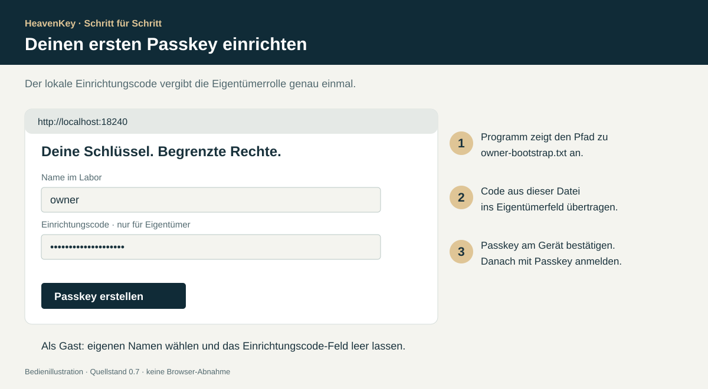
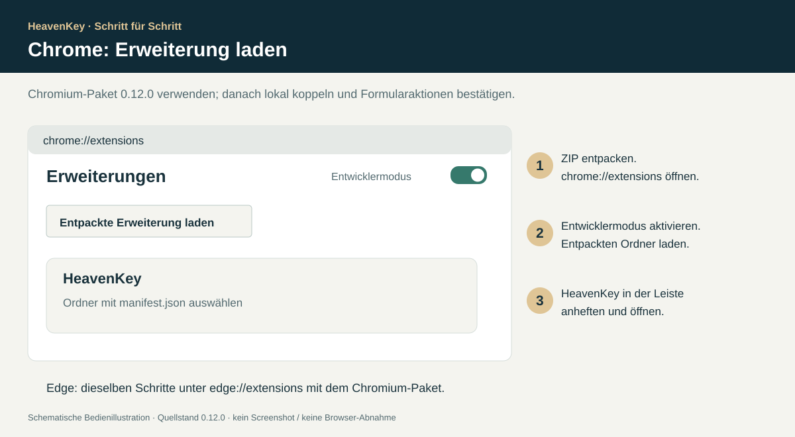
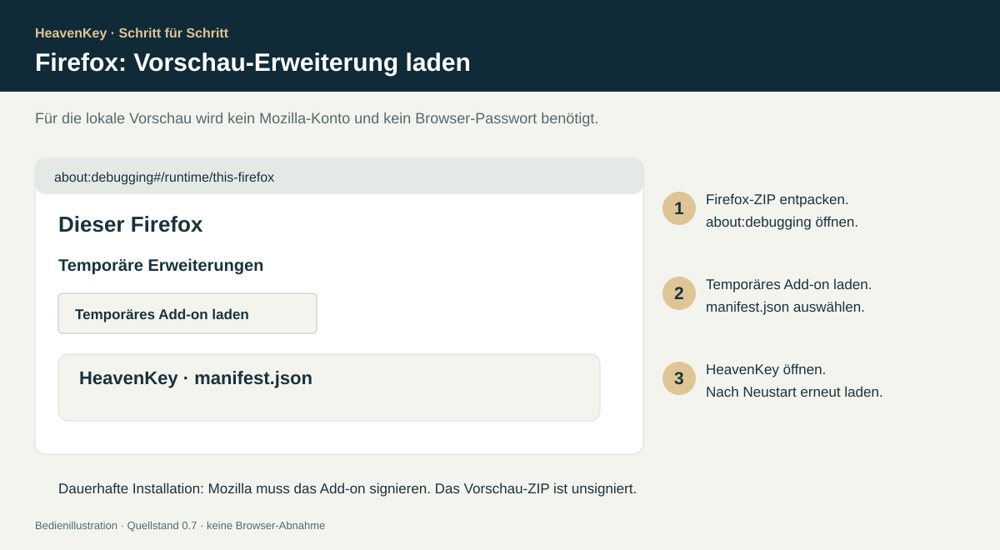

# HeavenKey einfach installieren

> Stand: **0.7.0, lokale Vorschau auf diesem Branch.** Die bereits veröffentlichten 0.6-Pakete enthalten die neuen Recovery-, Agenten- und Tresorfunktionen noch nicht. Diese Anleitung unterscheidet fertige Pakete und den aktuellen Quellstand. Es findet kein automatisches Cloud-Deployment statt.


Die Bilder sind **schematische Bedienillustrationen** mit den Bezeichnungen der Oberfläche. Neue Chrome-/Firefox-Screenshots konnten in der aktuellen Ausführungsumgebung nicht aufgenommen werden. Die reine temporäre Firefox-Add-on-Installation wurde erfolgreich geprüft; die vollständige Browserbedienung bleibt offen. Sie sind kein Nachweis einer Browser- oder Hardware-Abnahme.

## A · Fertiges Vorschau-Paket: ohne Entwicklungswerkzeuge

1. Öffne [Releases](https://github.com/Supersynergy/HeavenKey/releases) mit deinem berechtigten GitHub-Konto.
2. Wähle das passende Paket und entpacke das gesamte Archiv.
3. Starte die enthaltene Startdatei. Das Terminal bleibt geöffnet, solange HeavenKey läuft.

| Computer | Paket | Startdatei |
| --- | --- | --- |
| Mac mit Apple Silicon, z. B. M1–M4 | `macos-arm64.zip` | `Start HeavenKey.command` |
| Mac mit Intel-Prozessor | `macos-x64.zip` | `Start HeavenKey.command` |
| Windows 10/11, x64 | `windows-x64.zip` | `Start HeavenKey.cmd` |
| Linux x64 | `linux-x64.tar.gz` | `./start.sh` |
| Linux ARM64 | `linux-arm64.tar.gz` | `./start.sh` |

**Versionsnummer prüfen:** Für die neuen Funktionen muss im Paket mindestens 0.7.0 stehen. Ein vorhandenes 0.6-Paket bleibt der ältere Funktionsstand. Neue 0.7-Binärpakete für alle Plattformen und ihre Signierung sind nicht Bestandteil dieses Source-PRs.

Die Vorschau ist nicht vom Herausgeber signiert oder von Apple notarisiert. Prüfe Quelle und die zugehörige `SHA256SUMS`, bevor du eine Betriebssystemfreigabe erteilst. Ändere keine globalen Sicherheitseinstellungen. Auf dem Mac zeigt ` → Über diesen Mac`, ob Apple Silicon oder Intel verbaut ist.

## B · Aktuellen 0.7-Quellstand starten

Dieser Weg ist für den neuen Branch verfügbar. **Python 3.11+, Rustup und Bun 1.4.2** werden benötigt; unter Linux zusätzlich die üblichen C-/OpenSSL-Buildwerkzeuge und `pkg-config`, auf macOS die Xcode Command Line Tools. Der Schlüsselbund sollte entsperrt sein.

- [Rustup installieren](https://rustup.rs/) – verwendet die festgelegte Toolchain aus `rust-toolchain.toml`.
- [Bun installieren](https://bun.sh/docs/installation) – die hier festgelegte Version ist **1.4.2**.
- [Python installieren](https://www.python.org/downloads/) – bei Windows den Python Launcher mitinstallieren.

Repository mit deinem berechtigten GitHub-Konto klonen oder den Branch als ZIP herunterladen und entpacken. Öffne ein Terminal im Projektordner:

```sh
python3 scripts/first_run.py
```

Unter Windows:

```powershell
py -3 scripts/first_run.py
```

Der Assistent prüft die Werkzeuge, lädt festgelegte Abhängigkeiten, baut die Oberfläche und die API und öffnet anschließend HeavenKey. **`just`, Docker und eine Browser-Erweiterung sind für diesen Start nicht erforderlich.** Der erste Build benötigt einige Minuten und Internetzugang; die lokale Nutzung danach benötigt keinen Cloud-Login.

Alternativ nach der Werkzeuginstallation die Startdatei im Quellordner verwenden:

| System | Quelle starten |
| --- | --- |
| macOS | `Start-HeavenKey.command` |
| Windows | `Start-HeavenKey.cmd` |
| Linux | `./start-heavenkey.sh` |

Diese Quellstarter bauen das Programm; sie sind nicht mit den vorkompilierten Startern aus Abschnitt A zu verwechseln. `python3 scripts/first_run.py --check-only` prüft nur die vorhandenen Werkzeuge.

### Dein erster Passkey



1. Öffne `http://localhost:18240`, falls der Browser nicht automatisch startet.
2. Das Terminal nennt den Datenordner und den Pfad zu `owner-bootstrap.txt`.
3. Öffne diese Datei als Text, übertrage ihren Inhalt in **„Einrichtungscode · nur für Eigentümer“** und lasse den Kontonamen für den ersten Eigentümer bei `owner`.
4. Wähle **„Passkey erstellen“** und bestätige die Systemabfrage deines Geräts.
5. Wähle danach **„Mit Passkey anmelden“**.
6. Unter **„Meine Passkeys“** einen zweiten, unabhängigen Passkey hinzufügen.
7. Unter **„Wiederherstellung“** einen Einmalcode erstellen und **„Sicherung herunterladen“** wählen.

Ein Gast verwendet einen eigenen Kontonamen mit 3–32 ASCII-Buchstaben/Ziffern/Bindestrichen und lässt den Einrichtungscode leer. Gäste bekommen dadurch keine Eigentümerrechte. Die Eigentümerrolle wird einmalig vergeben.

### Wo liegen die Daten?

| System | Standard-Datenordner |
| --- | --- |
| macOS | `~/Library/Application Support/HeavenKey` |
| Windows | `%LOCALAPPDATA%\HeavenKey` |
| Linux | `$XDG_DATA_HOME/HeavenKey` oder `~/.local/share/HeavenKey` |

Der Dienst schützt seinen Signierschlüssel in `issuer.enc`. Der zugehörige Schutzschlüssel liegt standardmäßig im **macOS-Schlüsselbund, Windows Credential Manager oder Linux Secret Service**. Er wird nicht automatisch in eine Datei zurückgeschrieben, wenn dieser Dienst fehlt oder gesperrt ist.

Die SQLite-Datenbank mit Konto- und Berechtigungsmetadaten ist weiterhin unverschlüsselt. Persönliche Tresorinhalte werden separat im Browser verschlüsselt. Betriebssystemzugriff auf den laufenden Dienst und ausgelieferter Browsercode bleiben Teil der Vertrauensbasis.

### Linux ohne Desktop-Schlüsselbund / ausdrücklicher Dateibetrieb

Erzeuge einen Schutzschlüssel **außerhalb** des Datenordners. Ein vorhandener Schlüssel wird niemals überschrieben:

```sh
python3 scripts/first_run.py --protection-key-file /absoluter/privater/pfad/issuer-protection.key
```

Die explizite Option erstellt eine neue 32-Byte-Datei mit privaten Dateirechten, falls sie noch nicht existiert. Bei weiteren Starts denselben Pfad verwenden. Für einen schon gebauten Server:

```sh
export HEAVENKEY_KEY_FILE=/absoluter/privater/pfad/issuer-protection.key
./target/debug/uac-api --open
```

**Server-Backup:** Datenordner und zugehörigen Betriebssystem-Keystore beziehungsweise externe Schutzdatei gemeinsam wiederherstellbar, aber getrennt geschützt aufbewahren. Ein Konto-Einmalcode ersetzt den Schutzschlüssel des Servers nicht. Eine kopierte `issuer.enc` ohne den passenden Schutzschlüssel kann nicht geöffnet werden. Beim Verschieben des Datenordners ändert sich die Zuordnung zum nativen Keystore; ein solcher Umzug erfordert eine geplante Schlüsselübertragung.

## Chrome und Edge



1. `extension-chromium.zip` aus dem passenden Release entpacken. Für den Quellstand erzeugt `python3 scripts/package_release.py --extensions-only` die aktuellen Archive in `dist/`.
2. Chrome: `chrome://extensions`; Edge: `edge://extensions` öffnen.
3. **Entwicklermodus** einschalten.
4. **„Entpackte Erweiterung laden“** wählen und den Ordner auswählen, der `manifest.json` enthält.
5. HeavenKey optional über das Erweiterungsmenü anheften.
6. Im Popup Verbindung und Bereich auswählen und **„HeavenKey öffnen“** klicken.

Standard ist **„Auf diesem Computer“**, Port `18240`. Wähle **„Eigener HTTPS-Dienst“** nur für eine ausdrücklich eingerichtete HeavenKey-Installation mit bekannter Domain. Die Erweiterung speichert nur diese Verbindungseinstellung. Sie hat keine Webseiten-, Speicher-API-, Native-Messaging- oder Schlüsselberechtigung. Die Einstellung liegt im eigenen `localStorage` der Erweiterung.

Der Browser-Tab führt Anmeldung, Passkey-Dialog und sensible Bestätigungen aus. Die Erweiterung startet keinen Server und erzeugt keine eigenen Passkeys. Ihr Popup kann geschlossen werden, während der Vorgang im Tab weiterläuft.

## Firefox



1. `extension-firefox.zip` aus dem passenden Release entpacken oder wie oben erzeugen.
2. `about:debugging#/runtime/this-firefox` öffnen.
3. **„Temporäres Add-on laden“** wählen.
4. `manifest.json` im entpackten Firefox-Ordner auswählen.
5. HeavenKey über das Erweiterungsmenü öffnen.

**Die temporäre Installation endet beim Firefox-Neustart.** Eine normale dauerhafte Installation braucht eine von Mozilla signierte Erweiterung. Das aktuelle Vorschaupaket ist unsigniert; es lässt sich nicht durch bloßes Umbenennen in `.xpi` dauerhaft installieren. Firefox-Sicherheitsoptionen nicht global abschalten. Das Manifest enthält die erforderliche Add-on-ID und die Erklärung, dass keine Daten gesammelt werden.

Nach Änderungen an einer entpackten Erweiterung in Chrome **„Neu laden“** beziehungsweise in Firefox das temporäre Add-on erneut laden.

## Häufige Startprobleme

| Anzeige oder Problem | Konkreter nächster Schritt |
| --- | --- |
| `localhost` nicht erreichbar | HeavenKey-Programm starten und Terminal geöffnet lassen; Port mit dem Popup vergleichen. |
| `address already in use` | Bereits laufende Instanz verwenden oder einen anderen Port wählen: `python3 scripts/first_run.py --port 18245`. Im Popup denselben Port eintragen. |
| OS credential store locked/unavailable | Desktop-Schlüsselbund entsperren; bei bewusstem Headless-Betrieb die externe Schutzdatei wie oben konfigurieren. |
| protected file must have permissions 0600 | Unter Unix `chmod 600 /pfad/zur/schutzdatei` und den privaten Ordner prüfen. |
| issuer authentication failed | Passenden ursprünglichen Schutzschlüssel wiederherstellen. Ein neuer Schlüssel kann vorhandene Daten nicht entschlüsseln. |
| Kein Einrichtungscode-Feld nötig? | Als Gast ohne Code registrieren. Eigentümer verwenden nur die lokal angezeigte Datei. |
| Passkey-Abfrage abgebrochen | Erneut starten; die Änderung wurde dadurch nicht ausgeführt. |
| PRF nicht unterstützt | Normale Passkey-Anmeldung weiterverwenden; für den optionalen Tresor einen PRF-fähigen Browser und Passkey nutzen. |
| Nach fünf Minuten abgemeldet | Erneut mit Passkey anmelden. Der geöffnete Tresor wird im Browser gesperrt. |
| Firefox-Erweiterung verschwunden | Temporäres Add-on erneut laden; permanente Installation erfordert Signierung. |
| Ein Handy erreicht den lokalen Computer nicht | `localhost` bezeichnet immer das jeweilige Gerät. Für eine gemeinsame Installation ist eine geprüfte HTTPS-Bereitstellung nötig. |

## Weitere Anleitungen

- [Passkeys, Rechte, Recovery und Tresor benutzen](PASSKEY-GUIDE.md)
- [Agentenprogramm und CRM-Pilot](AGENT-GUIDE.md)
- [Konfiguration und Sicherheitsgrenzen](PASSKEY-PLATFORM.md)
- [Tatsächlich durchgeführte Prüfungen](V07-VERIFICATION.md)

Offizielle Browserquellen: [Chrome: Erweiterung entpackt laden](https://developer.chrome.com/docs/extensions/get-started/tutorial/hello-world#load-unpacked), [Firefox: temporär installieren](https://extensionworkshop.com/documentation/develop/temporary-installation-in-firefox/), [Firefox: Signierung](https://extensionworkshop.com/documentation/publish/signing-and-distribution-overview/).
