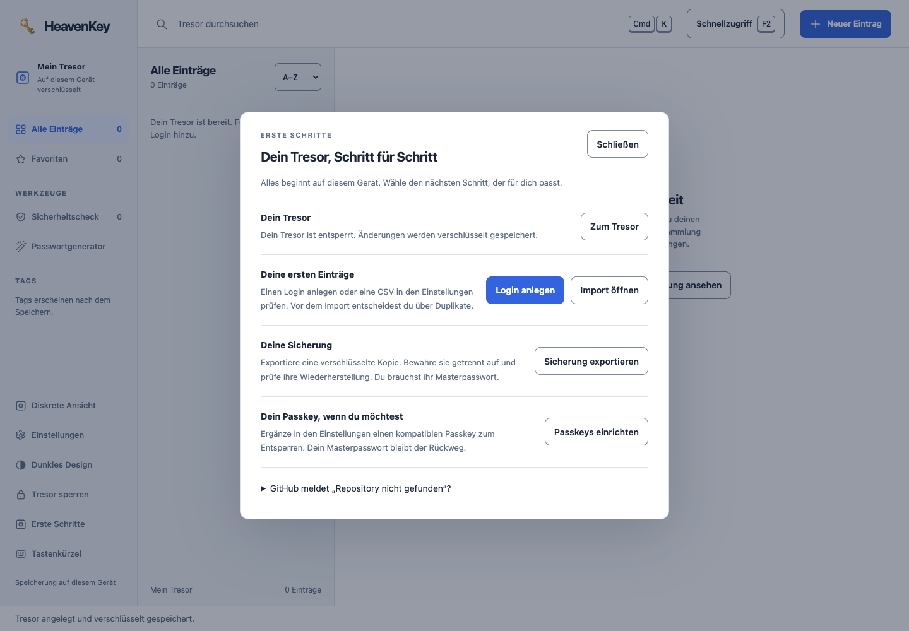
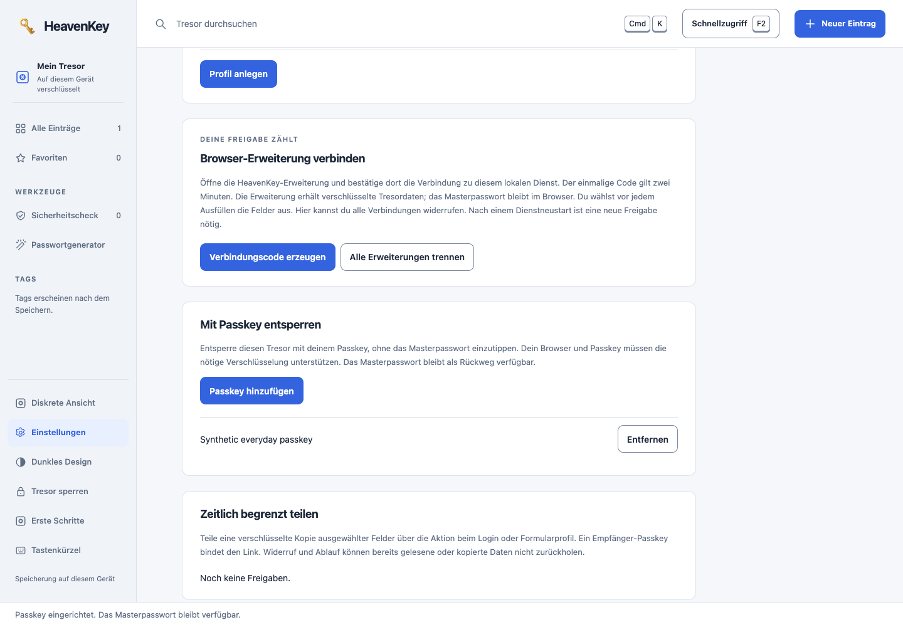
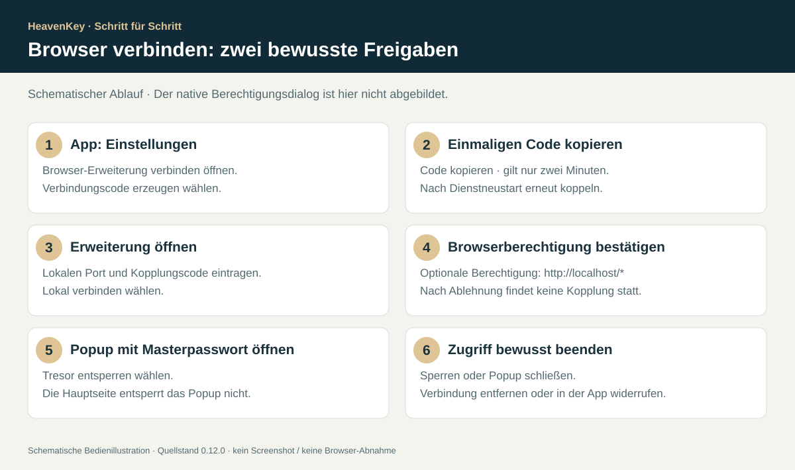
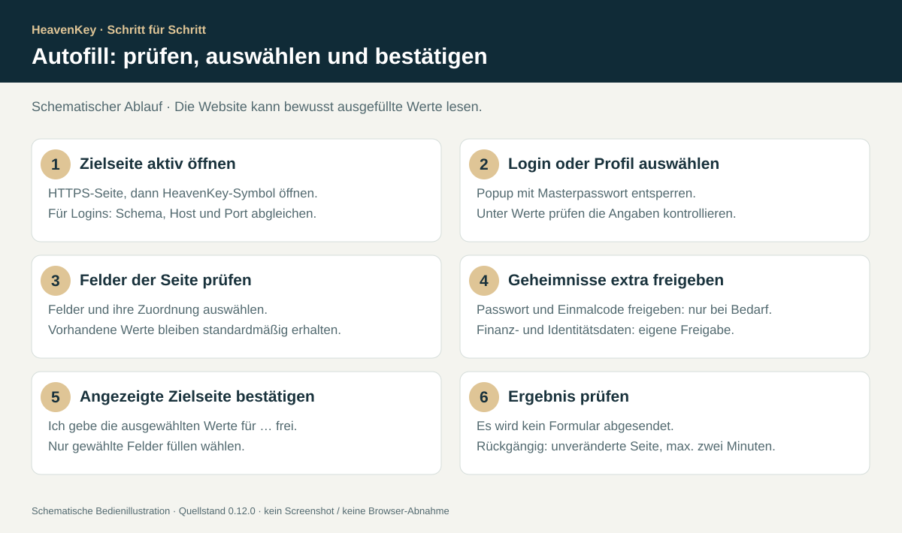

# HeavenKey 0.12.0 einfach installieren

Diese Anleitung gehört zum [Release 0.12.0 vom 17. Oktober 2026](https://github.com/Supersynergy/HeavenKey/releases/tag/v0.12.0). Sie führt vom Download zum lokalen Passworttresor und zum bestätigten Ausfüllen im Browser. Ein aktueller Browser genügt; fertige Pakete benötigen kein Rust, Bun, Python, Docker oder HeavenKey-Konto. Ein Passkey ist optional.

**Bereits installiert?** Zuerst im bisherigen Tresor eine verschlüsselte Sicherung exportieren. Diese Anleitung bleibt auf 0.12.0 festgelegt; für neuere Releases gilt zusätzlich die [aktuelle Paket-Anleitung](DISTRIBUTION.md). Das getrennte [Passkey-Zugangslabor](LAB-INSTALLATION.md) hat eigene Einrichtungsschritte.

Die PNG-Bilder zeigen die **tatsächliche App aus dem Stand 0.12.0 mit synthetischen Daten**. Die SVG-Ablaufbilder sind **schematische Darstellungen, keine Screenshots**. Herkunft, Dateihashes und offene Prüfungen stehen im [Prüfprotokoll](INSTALLATION-VERIFICATION.md). Betriebssystem- und Browserdialoge können je nach Version und Sprache anders aussehen.

[Download](#1--download-und-sha-256-prüfen) · [macOS](#2--macos-starten) · [Windows](#3--windows-starten) · [Tresor](#4--ersten-tresor-anlegen) · [Sicherung](#5--verschlüsselte-sicherung-erstellen-und-prüfen) · [Chrome](#6--chrome-und-edge-installieren) · [Firefox](#7--firefox-temporär-installieren) · [Koppeln](#8--browser-koppeln-und-berechtigung-bestätigen) · [Autofill](#9--autofill-bewusst-ausführen) · [Passkey](#10--optional-mit-passkey-entsperren) · [Freigaben](#11--befristete-freigaben-und-andere-geräte)

## 1 · Download und SHA-256 prüfen

1. Öffne [genau Release v0.12.0](https://github.com/Supersynergy/HeavenKey/releases/tag/v0.12.0) im Browser und melde dich mit einem **GitHub-Konto mit Zugriff auf Supersynergy/HeavenKey** an. Repository und Downloads sind privat.
2. Lade unter **Assets** dein Desktop-Paket sowie `SHA256SUMS` herunter. Für Autofill kommt das passende Erweiterungs-ZIP hinzu. **Source code (zip)** ist kein fertiges Programmpaket.
3. Prüfe die Prüfsumme vor dem Entpacken beziehungsweise Starten. Verwende die `SHA256SUMS` aus demselben Release.

| Gerät / Browser | Exakter Asset-Dateiname | Startdatei / zu ladende Datei |
| --- | --- | --- |
| Mac mit Apple Silicon, z. B. M1–M4 | `HeavenKey-0.12.0-macos-arm64.zip` | `Start HeavenKey.command` |
| Mac mit Intel-Prozessor | `HeavenKey-0.12.0-macos-x64.zip` | `Start HeavenKey.command` |
| Windows x64 | `HeavenKey-0.12.0-windows-x64.zip` | `Start HeavenKey.cmd` |
| Chrome ab 120 / Edge mit passender Chromium-Version | `HeavenKey-0.12.0-extension-chromium.zip` | Ordner mit `manifest.json` |
| Firefox ab 140 | `HeavenKey-0.12.0-extension-firefox.zip` | `manifest.json` |
| Linux x64 / ARM64 | `HeavenKey-0.12.0-linux-x64.tar.gz` / `HeavenKey-0.12.0-linux-arm64.tar.gz` | `./start.sh`; siehe [Paket-Anleitung](DISTRIBUTION.md) |

Auf dem Mac zeigt ** → Über diesen Mac** den Chip beziehungsweise Prozessor. Für Windows ARM gibt es in 0.12.0 kein natives Paket; die x64-Emulation ist hier nicht abgenommen.

**macOS:** Öffne Terminal im Downloadordner. Für Apple Silicon:

```sh
shasum -a 256 "HeavenKey-0.12.0-macos-arm64.zip"
```

Bei Intel ersetze `arm64` durch `x64`. Vergleiche die vollständigen **64 Hex-Zeichen** mit der Zeile desselben Dateinamens in `SHA256SUMS`.

**Windows:** Öffne PowerShell im Downloadordner:

```powershell
Get-FileHash -Algorithm SHA256 -LiteralPath ".\HeavenKey-0.12.0-windows-x64.zip"
Get-Content -LiteralPath ".\SHA256SUMS"
```

Vergleiche `Hash` mit der Zeile für das Windows-ZIP; Groß-/Kleinschreibung der Hex-Zeichen ist unerheblich. Prüfe Erweiterungs-ZIPs ebenso, mit ihrem jeweiligen Dateinamen. Nicht die gesamte Prüfliste gegen einen Ordner mit nur einem der sieben Pakete prüfen: Die übrigen Dateien würden als fehlend gemeldet.

**Bei Abweichung nicht starten.** Erneut aus dem berechtigten Release herunterladen. Eine passende SHA-256 bestätigt die Übereinstimmung mit der Prüfliste; sie ersetzt keine Herausgebersignatur und kein Sicherheits-Audit.


*Schematische Darstellung für 0.12.0, kein Screenshot.*

## 2 · macOS starten

1. Entpacke das geprüfte ZIP vollständig. Behalte den gesamten Ordner `HeavenKey-0.12.0-macos-arm64` beziehungsweise `HeavenKey-0.12.0-macos-x64` zusammen; verschiebe ihn bei Bedarf an einen dauerhaften Ort.
2. Öffne darin **`Start HeavenKey.command`**. Der Starter führt `heavenkey --password-manager --open` aus.
3. Die Pakete sind **nicht vom Herausgeber signiert und nicht Apple-notarisiert**. Falls macOS die Herkunft blockiert: Nach dem ersten Öffnungsversuch unter **Systemeinstellungen → Datenschutz & Sicherheit → Dennoch öffnen** nur die konkret geprüfte Datei freigeben und den erneuten Dialog bestätigen. Falls anschließend `heavenkey` blockiert wird, gilt die Prüfung auch für diese Datei. Siehe [Apple-Anleitung](https://support.apple.com/en-us/102445). Malware- oder Beschädigungswarnungen nicht als bloße Herkunftswarnung behandeln.
4. Lass das Terminal geöffnet. Der Browser sollte **`http://localhost:18240/passwords/`** anzeigen; öffne diese Adresse sonst selbst.

Falls nach dem Entpacken nur Ausführungsrechte fehlen, im entpackten Programmordner:

```sh
chmod +x "Start HeavenKey.command" heavenkey
./"Start HeavenKey.command"
```

Das ersetzt keine Herkunftsprüfung. Gatekeeper nicht global deaktivieren und keine rekursive Quarantäne-Entfernung anwenden. **Ctrl+C im Terminal** beendet den Dienst.

## 3 · Windows starten

1. Wähle beim geprüften ZIP **Alle extrahieren**. Öffne den entpackten Unterordner `HeavenKey-0.12.0-windows-x64`; starte nicht direkt aus der ZIP-Vorschau.
2. Doppelklicke **`Start HeavenKey.cmd`**. `HeavenKey.exe` und die übrigen Paketdateien bleiben im selben Ordner.
3. Das Paket ist **nicht vom Herausgeber signiert**. Falls SmartScreen eine unbekannte Anwendung meldet und du Quelle sowie SHA-256 geprüft hast, kannst du eine angebotene Einzel-Freigabe über **Weitere Informationen → Trotzdem ausführen** prüfen. Die Option kann durch Richtlinien fehlen. Defender und SmartScreen nicht abschalten; eine konkrete Schadsoftwaremeldung nicht übergehen. [Microsoft erläutert die Reputationsprüfung](https://learn.microsoft.com/en-us/windows/apps/package-and-deploy/smartscreen-reputation).
4. Lass das Konsolenfenster geöffnet. Öffne bei Bedarf **`http://localhost:18240/passwords/`** selbst. **Ctrl+C** beendet den Dienst.

Der Release nennt Wine als Windows-Prüfumgebung. Ein erfolgreicher Wine-Lauf ist keine Abnahme auf einem echten Windows-PC oder mit Windows Hello.

## 4 · Ersten Tresor anlegen


*Unbearbeitete App-Aufnahme aus v0.12.0; keine Betriebssystemaufnahme.*

1. Prüfe die Adresse **`http://localhost:18240/passwords/`**. Verwende durchgehend `localhost`, nicht abwechselnd `127.0.0.1` oder einen anderen Port.
2. Unter **Lokalen Tresor anlegen** ein eigenes, langes Masterpasswort eingeben: **14–1024 Zeichen**. Im zweiten Feld wiederholen und **Tresor anlegen** wählen. Bewahre es getrennt von der Sicherung auf; HeavenKey kann es nicht zurücksetzen.
3. Wähle **Neuer Eintrag** beziehungsweise **Ersten Login anlegen**. Zum Üben ausschließlich erfundene Daten verwenden. Trage Titel, Nutzername, Passwort und die vollständige Webadresse ein; **Generieren** kann ein Passwort erstellen.
4. Wähle **Verschlüsselt speichern**. Der Eintrag sollte in der Liste erscheinen. Für späteres Login-Autofill müssen Schema, Host und Port der gespeicherten Webadresse zur Zielseite passen.

Du brauchst hier **keinen Eigentümercode, kein Gastkonto und keinen Signierschlüssel**. Diese gehören zum [Zugangslabor](LAB-INSTALLATION.md). Bereits vorhandene Tresore zeigen die Entsperrmaske; erst nach dem Entsperren weiterarbeiten.

## 5 · Verschlüsselte Sicherung erstellen und prüfen



*Der Einrichtungsassistent ist über **Erste Schritte** erreichbar. Er zeigt den tatsächlichen Sicherungs- und Passkey-Einstieg.*

1. Öffne **Einstellungen → Sicherungen und Import → Verschlüsselte Sicherung herunterladen**. Alternativ **Erste Schritte → Sicherung exportieren**.
2. Der Browser lädt **`heavenkey-password-vault.json`** herunter; bei mehrfachen Downloads kann er einen Namenszusatz anfügen. Die Datei enthält den verschlüsselten Tresor einschließlich Formularprofilen. Das Masterpasswort der Sicherung wird zum Öffnen benötigt. Sie ersetzt keine Sicherung der separaten Labordaten.
3. Bewahre eine Kopie an einem zweiten geschützten Ort auf. Nach weiteren Änderungen erneut exportieren; alte Dateien aktualisieren sich nicht.
4. Prüfe die Wiederherstellung zuerst mit Beispieldaten in einem **separaten, noch unbenutzten Datenordner**. Lass die normale Instanz unverändert laufen und starte aus dem entpackten Programmordner eine Testinstanz:

macOS:

```sh
./heavenkey --password-manager --port 18245 --data-dir "$HOME/HeavenKey-Wiederherstellungstest-012" --open
```

Windows, in PowerShell:

```powershell
.\HeavenKey.exe --password-manager --port 18245 --data-dir "$env:LOCALAPPDATA\HeavenKey-Wiederherstellungstest-012" --open
```

5. Prüfe die Testadresse **`http://localhost:18245/passwords/`**. Wähle **Ich habe schon eine Sicherung** beziehungsweise **Sicherung wiederherstellen**, die JSON-Datei und deren damaliges Masterpasswort. Bestätige das Ersetzen **nur im Testordner** und wähle **Sicherung prüfen und wiederherstellen**. Prüfe den Beispielleintrag, sperre und entsperre erneut. Beende anschließend nur diese Testinstanz mit Ctrl+C.

Eine Wiederherstellung ersetzt alle Logins und Profile im Ziel. Vom Sperrbildschirm aus gilt danach das Masterpasswort der Sicherung; im bereits entsperrten Tresor bleibt dessen aktuelles Masterpasswort gültig. Eine gesperrte Wiederherstellung entfernt Passkey-Umschläge und widerruft dort bestehende Freigaben. Details: [Passwortmanager](PASSWORD-MANAGER.md).

## 6 · Chrome und Edge installieren


*Schematische Darstellung für 0.12.0, kein Chrome-Screenshot.*

1. Prüfe **`HeavenKey-0.12.0-extension-chromium.zip`** mit `SHA256SUMS` und entpacke es in einen eigenen dauerhaften Ordner. Nicht das Desktop-ZIP verwenden.
2. Gib **`chrome://extensions`** in die Adressleiste ein; bei Edge **`edge://extensions`**.
3. Aktiviere **Entwicklermodus** und wähle **Entpackte Erweiterung laden**.
4. Wähle den entpackten **Ordner**, der `manifest.json`, `popup.html` und `smart-popup.js` direkt enthält. Prüfe auf der HeavenKey-Karte die Version **0.12.0**.
5. Hefte HeavenKey im Erweiterungsmenü an. Der Ordner muss erhalten bleiben. Nach einem Austausch der Dateien auf der Erweiterungskarte **Neu laden** wählen.
6. Weiter mit [Browserkopplung](#8--browser-koppeln-und-berechtigung-bestätigen). Die Erweiterung startet den lokalen Dienst nicht selbst.

## 7 · Firefox temporär installieren


*Schematische Darstellung für 0.12.0, kein Firefox-Screenshot. Die vollständige Firefox-Bedienung bleibt offen.*

1. Verwende **Firefox ab 140**. Prüfe **`HeavenKey-0.12.0-extension-firefox.zip`** mit `SHA256SUMS` und entpacke es vollständig in einen eigenen Ordner.
2. Gib **`about:debugging#/runtime/this-firefox`** in die Adressleiste ein.
3. Wähle **Temporäres Add-on laden** und diesmal die **Datei `manifest.json`** im Firefox-Erweiterungsordner. Prüfe die Version 0.12.0 und öffne HeavenKey über das Erweiterungsmenü.
4. Weiter mit [Browserkopplung](#8--browser-koppeln-und-berechtigung-bestätigen). Bei geändertem Paket das temporäre Add-on neu laden und die Verbindung prüfen.

**Beim Firefox-Neustart endet die temporäre Installation.** Lade sie danach erneut und kopple bei Bedarf neu. Für eine normale dauerhafte Installation ist Mozilla-Signierung erforderlich; eine signierte XPI liegt diesem Release nicht bei. Bloßes Umbenennen des ZIPs in `.xpi` genügt nicht. Signaturprüfung nicht deaktivieren. Siehe [temporäre Installation](https://extensionworkshop.com/documentation/develop/temporary-installation-in-firefox/) und [Signierung](https://extensionworkshop.com/documentation/publish/signing-and-distribution-overview/).

## 8 · Browser koppeln und Berechtigung bestätigen



*Echte App-Aufnahme: **Verbindungscode erzeugen** startet die Kopplung. Der sichtbare Passkey wurde mit einem virtuellen WebAuthn-Gerät eingerichtet; das ist kein Hardware-Nachweis.*

1. Starte den normalen Passwortmanager auf Port **18240**, entsperre ihn und öffne **Einstellungen → Browser-Erweiterung verbinden → Verbindungscode erzeugen**.
2. Kopiere den **Einmaligen Verbindungscode** über **Code kopieren**. Er gilt **zwei Minuten und genau einmal**.
3. Öffne das HeavenKey-Symbol im gewünschten Browser. Im oberen Bereich **Passwörter & Formulare** den **Lokalen Port** (`18240`) und den **Kopplungscode** eintragen; **Lokal verbinden** wählen.
4. Bestätige die dabei angeforderte optionale Browserberechtigung für **`http://localhost/*`**, wenn du diese lokale Verbindung möchtest. Sie umfasst localhost unabhängig vom Port; die Erweiterung verbindet sich mit dem eingetragenen Port. Bei bereits erteilter Berechtigung kann der Dialog entfallen. Nach Ablehnung wird nicht gekoppelt; erneut versuchen und nötigenfalls einen frischen Code erzeugen.
5. Nach **Gekoppelt** das **Masterpasswort** im Popup eingeben und **Tresor entsperren** wählen. Ein im Haupttab entsperrter Tresor entsperrt das Popup nicht automatisch. Das optionale Passkey-Entsperren dieser Version gehört zur Weboberfläche; das Popup verlangt weiter das Masterpasswort.



*Schematischer Ablauf, kein nachgebildeter Berechtigungsdialog.*

Die Erweiterung nutzt **`activeTab`, `scripting`, `storage` und `contextMenus`**. `activeTab` erlaubt nach deinem Aufruf vorübergehenden Zugriff auf die aktive Seite; `scripting` führt dort die Formularhilfe aus. Verbindung und eigenes Kopplungstoken werden über `storage.local` gespeichert. Es gibt keinen dauerhaften Zugriff auf alle Websites und kein Native Messaging. Die bisherige Aussage, sie habe keine Webseitenberechtigungen, gilt für 0.12.0 nicht mehr.

Popup schließen, **Sperren** wählen oder zwei Minuten nicht bedienen sperrt die Popup-Sitzung. **Verbindung auf diesem Browser entfernen** trennt sie; in der App widerruft **Alle Erweiterungen trennen** sämtliche Kopplungen. Nach einem Dienstneustart ist eine neue Kopplung erforderlich.

Der untere Bereich **HeavenKey & Zugangslabor öffnen** ist nur ein zusätzlicher Seitenstarter. **Eigener HTTPS-Dienst** dort gilt für das separat eingerichtete Zugangslabor. Die Passwortmanager-Formularhilfe wird in 0.12.0 ausschließlich mit dem lokalen Dienst gekoppelt.

## 9 · Autofill bewusst ausführen



*Schematische Darstellung mit den tatsächlichen Bedienelement-Bezeichnungen aus 0.12.0; kein Browser-Screenshot.*

1. Öffne zuerst die gewünschte **HTTPS-Loginseite** im aktiven Tab. Lokale HTTP-Testseiten sind ebenfalls erlaubt. Browserinterne Seiten wie `chrome://` und fremde eingebettete Frames sind keine unterstützten Ziele.
2. Öffne **auf dieser Zielseite** das HeavenKey-Symbol, entsperre das Popup und suche einen Login oder ein Formularprofil. Wähle den Eintrag und prüfe **Werte prüfen**. Für Logins müssen **Schema, Host und Port** genau der gespeicherten Website entsprechen; bei einer anderen Subdomain wird nicht gefüllt.
3. Wähle **Felder der Seite prüfen**. Prüfe die erkannten Felder und ihre Wertzuordnung; wähle nur die gewünschten Felder aus. Gewöhnliche leere Felder können vorausgewählt sein.
4. Für ein Passwort beziehungsweise TOTP zusätzlich **Passwort und Einmalcode freigeben** aktivieren und das entsprechende Zielfeld auswählen. Finanz- und Identitätsangaben benötigen **Finanz- und Identitätsdaten freigeben**. **Bereits befüllte Werte überschreiben** nur bei Bedarf aktivieren.
5. Prüfe die angezeigte Website-Origin und bestätige **Ich gebe die ausgewählten Werte für … frei.** Danach **Nur gewählte Felder füllen** wählen. Nach geänderten Zuordnungen oder Freigaben die Zielseite erneut bestätigen.
6. Kontrolliere die Eingaben auf der Website. **Das Formular wird nicht abgesendet.** Anmelden beziehungsweise Absenden entscheidest du selbst. **Letzte Füllung rückgängig** ist nur in derselben Sitzung, auf der unveränderten Zielseite und höchstens zwei Minuten möglich.

Die Website und ihre Skripte können ausgefüllte Werte wie manuelle Eingaben lesen. Rückgängig oder Sperren kann bereits gelesene Daten nicht zurückholen. Einwilligungen, AGB, Newsletter und Zahlungsarten werden nicht automatisch gesetzt. Chrome-Berechtigungen erklärt die offizielle Dokumentation zu [activeTab](https://developer.chrome.com/docs/extensions/develop/concepts/activeTab) und [optionalen Berechtigungen](https://developer.chrome.com/docs/extensions/reference/api/permissions).

## 10 · Optional mit Passkey entsperren

1. Erstelle zuerst die verschlüsselte Sicherung und halte das Masterpasswort verfügbar. Entsperre die **Weboberfläche** auf der bisherigen localhost-Adresse.
2. Unter **Einstellungen → Mit Passkey entsperren → Passkey hinzufügen** einen Namen vergeben und das Masterpasswort bestätigen. **Passkey einrichten** wählen.
3. Folge den **zwei Browser-/Systemprüfungen**: Passkey anlegen und anschließend dessen PRF-Ausgabe prüfen. Benutzerverifikation kann je nach Gerät etwa Biometrie oder PIN verlangen. Nur bei erfolgreicher PRF-Prüfung erscheint der aktive Eintrag in der Liste.
4. Wähle **Tresor sperren**, dann **Mit Passkey entsperren**, den eingerichteten Passkey und bestätige die Geräteabfrage. Prüfe anschließend auch den Rückweg mit dem Masterpasswort.

Die oben abgebildeten Einstellungen zeigen einen tatsächlich registrierten **virtuellen** PRF-Passkey. Die konkrete Kombination aus Betriebssystem, Browser und physischem Passkey muss separat geprüft werden. Ohne PRF oder nach Abbruch weiter das Masterpasswort verwenden; ein normaler Passkey allein garantiert kein PRF-Entsperren.

Tresor und Passkey-Umschlag werden nicht automatisch zwischen Geräten synchronisiert. Ein Masterpasswortwechsel oder eine Wiederherstellung vom Sperrbildschirm entfernt bisherige Passkey-Umschläge und widerruft Freigaben; danach Passkeys neu einrichten. Mehr dazu unter [Passkeys und Freigaben](ACCESS-AND-SHARING.md).

## 11 · Befristete Freigaben und andere Geräte


1. Beim Login oder Formularprofil **Befristet teilen** wählen.
2. Die Felder **einzeln auswählen**; standardmäßig ist keines gewählt. Laufzeit festlegen: **fünf Minuten, eine Stunde, ein Tag oder sieben Tage**. Die Weitergabe ausdrücklich bestätigen.
3. Den vollständigen Link vertraulich an den vorgesehenen Empfänger übermitteln. Der erste verifizierte Empfänger bindet seinen eigenen Passkey; spätere Abrufe erfordern denselben Passkey. Das beweist keine Personenidentität. Für diesen Empfänger-Passkey ist PRF nicht nötig.
4. Unter Einstellungen lassen sich Freigaben widerrufen. Geteilt wird eine verschlüsselte Kopie der damaligen Werte. Ablauf und Widerruf verhindern weitere Abrufe; bereits gespeicherte Angaben können nicht zurückgeholt werden.

**Ohne zusätzliche Einrichtung funktioniert `http://localhost:18240/share/…` nur auf demselben Computer und nur bei laufendem Dienst.** Auf dem Handy zeigt `localhost` auf das Handy.

Für andere Geräte muss ein Betreiber **vor dem Erstellen** der Freigabe eine erreichbare HTTPS-Origin mit gültigem TLS, `HEAVENKEY_SHARE_ORIGIN` und einem getrennten Reverse-Proxy einrichten. Der Dienst bleibt an Loopback gebunden. Öffentlich dürfen nur Empfängerseite, nötige Assets und die drei Empfänger-API-Pfade verfügbar sein; Verwaltungs- und Tresorpfade bleiben lokal. Host und Origin dürfen nicht auf localhost umgeschrieben werden. Der [Betriebsabschnitt mit exakter Pfadliste](ACCESS-AND-SHARING.md#lokaler-betrieb-und-andere-geräte) ist dafür verbindlich. Der Release richtet kein Hosting, keine Synchronisation und keinen mobilen Credential-Provider ein. Öffentlicher HTTPS-Betrieb bleibt separat zu prüfen.

## 12 · Daten behalten, aktualisieren und Fehler beheben

| System | Standard-Datenordner |
| --- | --- |
| macOS | `~/Library/Application Support/HeavenKey` |
| Windows | `%LOCALAPPDATA%\HeavenKey` |
| Linux | `$XDG_DATA_HOME/HeavenKey` oder `~/.local/share/HeavenKey` |

Der Passwortmanager speichert den verschlüsselten Tresor in `passwords.sqlite`. Vor einem Update exportieren, den Dienst mit Ctrl+C beenden, das geprüfte neue Paket vollständig in einen Programmordner entpacken und neu starten. Der Datenordner bleibt erhalten. Erweiterung separat aktualisieren, ihre Version prüfen und neu koppeln. Ein Update benötigt keine erneute Tresoranlage. Keine ältere Version über neuere Daten starten; zuerst in einem separaten Datenordner prüfen.

| Problem | Nächster Schritt |
| --- | --- |
| GitHub: 404 / „Could not resolve to a Repository“ | Im Browser mit dem berechtigten Konto anmelden und v0.12.0 öffnen. Eine andere GitHub-Sitzung oder ein Release erteilt keine Berechtigung. Bei fehlendem Zugriff muss der Eigentümer ihn vergeben. |
| `localhost` nicht erreichbar | Starter und offenes Terminal prüfen; `http://localhost:18240/passwords/` manuell öffnen. Die Erweiterung startet keinen Dienst. |
| `address already in use` | Laufende Instanz verwenden oder beenden. Für einen anderen Port den Starter mit `--port 18245` aus einem Terminal aufrufen und im Popup denselben Port setzen. |
| Eigentümercode statt Masterpasswort sichtbar | Zugangslabor geöffnet. Den Paket-Starter verwenden und `/passwords/` öffnen. |
| Kopplungscode ungültig / abgelaufen | Neuen Einmalcode erzeugen, richtigen Dienstport und localhost-Berechtigung prüfen. Nach Dienstneustart neu koppeln. |
| Popup wieder gesperrt | Mit Masterpasswort neu entsperren; Schließen oder zwei Minuten Inaktivität sperren das Popup. |
| Autofill verweigert | HTTPS-Ziel, genaue Login-Origin, aktive Zielseite, Feldzuordnung und ausdrückliche Freigaben prüfen. Nach Seitennavigation erneut prüfen. |
| Firefox-Erweiterung verschwunden | Temporär erneut laden; dauerhafte Standardinstallation benötigt Mozilla-Signierung. |
| PRF nicht unterstützt / Passkey abgebrochen | Mit dem Masterpasswort weiterarbeiten; kompatible Kombination separat prüfen. |
| Masterpasswort vergessen | Sicherung mit ihrem damaligen Passwort im getrennten Testordner prüfen. Ohne gültiges Passwort gibt es keinen Reset; einen noch funktionierenden Passkey nicht entfernen. |
| Schlüsselbund-/`issuer.enc`-Fehler | Betrifft das Zugangslabor; dessen [gesonderte Schlüssel- und Backup-Anleitung](LAB-INSTALLATION.md) verwenden. |

## 13 · Optional aus dem Quellstand 0.12.0 starten

Nur für Entwicklung: GitHub-Zugriff, Git, **Python 3.11+**, **Rustup mit der festgelegten Toolchain** und **Bun 1.4.2** sowie die jeweiligen nativen Buildwerkzeuge werden benötigt. macOS benötigt Xcode Command Line Tools; Linux C-/OpenSSL-Werkzeuge und `pkg-config`. Windows-Buildwerkzeuge hängen von der Rust-Toolchain ab. Der Erstbuild lädt Abhängigkeiten aus dem Internet.

```sh
git clone --branch v0.12.0 --depth 1 https://github.com/Supersynergy/HeavenKey.git HeavenKey-v0.12.0
cd HeavenKey-v0.12.0
python3 scripts/first_run.py --check-only
python3 scripts/first_run.py
```

Unter Windows die beiden Python-Aufrufe mit `py -3` statt `python3` ausführen. Der Standard ist jetzt der **Passwortmanager**; nur `--lab` startet das Zugangslabor. `just` und Docker sind für diesen Assistenten nicht erforderlich.

Wer Erweiterungen selbst erzeugt, muss **vor** dem Paketieren bauen:

```sh
bun install --frozen-lockfile --ignore-scripts
bun scripts/build_extension.ts
python3 scripts/package_release.py --extensions-only
```

Die Archive liegen danach unter `dist/` mit den vollständigen 0.12.0-Dateinamen. Diese Quellbauwege wurden hier anhand der Skripte geprüft, mangels Rust/Bun jedoch nicht ausgeführt. Weitere Informationen: [Entwicklung](DEVELOPMENT.md), [Bildherkunft und Prüfstatus](INSTALLATION-VERIFICATION.md), [separates Zugangslabor](LAB-INSTALLATION.md).
