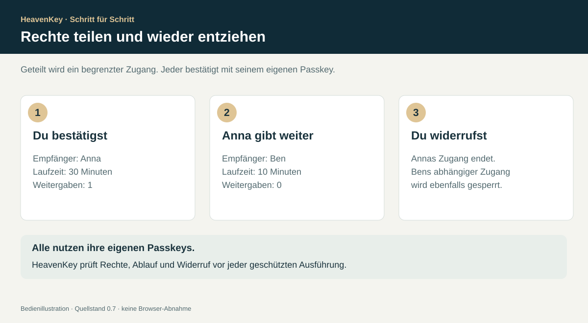
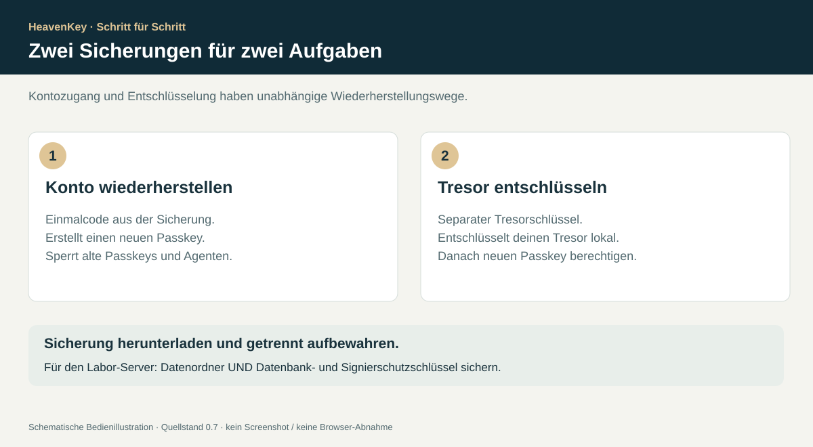

# Passkeys und Freigaben benutzen

## Anmelden und Ersatzschlüssel hinterlegen

Nach dem Einrichten mit deinem Kontonamen und einem aktiven Passkey anmelden. Ein Konto kann bis zu acht aktive Passkeys haben. Unter **„Meine Passkeys“** einen Namen vergeben, **„Passkey hinzufügen“** wählen, die Erweiterung der Kontoberechtigung mit einem vorhandenen Passkey bestätigen und dann den neuen Passkey erstellen.

Bestehende Freigaben gehören zur stabilen Kontoidentität. Ein zusätzlicher Passkey erhält Zugriff auf diese Konto-Freigaben. Das Hinzufügen eines Passkeys zum Konto berechtigt ihn jedoch **nicht automatisch zum verschlüsselten Tresor**; das folgt separat nach dem Entsperren.

Einen verlorenen Passkey über **„Passkey widerrufen“** sperren und mit einem aktiven Schlüssel bestätigen. Der letzte aktive Passkey ist vor normalem Widerruf geschützt. Widerruf beendet die Kontositzungen. Agentenaufträge, die mit dem widerrufenen Schlüssel autorisiert wurden, sind nicht mehr ausführbar. Freigaben des Kontos werden separat widerrufen.

## Zugang teilen, lesen und widerrufen

1. Der Empfänger registriert zuerst sein eigenes Gastkonto.
2. Unter **„Zugang vergeben“** Name und Gültigkeit von 1–3600 Sekunden angeben.
3. Die angezeigten Grenzen prüfen und mit Passkey bestätigen.
4. Für eine erlaubte Weitergabe stattdessen **„Begrenzte Weitergabe“** verwenden und 0–4 zusätzliche Weitergaben erlauben.
5. Der Empfänger sieht den Zugang nach der Anmeldung. **„Dokument lesen“** verlangt eine frische Passkey-Bestätigung; **„Mit Sitzung lesen“** verwendet die bereits authentifizierte, fünf Minuten gültige Sitzung für diesen begrenzten Lesezugriff.
6. **„Weitergabe widerrufen“** sperrt den Zugang einschließlich aller abhängigen Nachfolger. Die aktuelle Kette wird beim nächsten Aufruf erneut geprüft, auch nach Neustart.

Ein Nachfolger kann weder mehr Rechte noch eine längere Laufzeit oder mehr Weitergaben erhalten. Höchstens fünf Glieder sind möglich. Die 60-Sekunden-Bestätigung gilt einmalig für die genau angezeigten Parameter und dieselbe Sitzung. Ein bereits gelesenes oder kopiertes Dokument lässt sich durch Widerruf nicht zurückholen.

## Alle Passkeys verloren

**Vorbereiten:** Angemeldet unter **„Wiederherstellung“** einen Einmalcode erstellen, bestätigen und **„Sicherung herunterladen“** wählen. Jeder neue Code ersetzt den vorherigen. Der Dienst speichert nur einen konto- und zweckgebundenen SHA-256-Digest eines zufälligen 256-Bit-Codes. Der Code ist kein Passwort zum regelmäßigen Anmelden.

**Wiederherstellen:** Unter **„Alle Passkeys verloren?“** Kontonamen, gesicherten Code und einen Namen für den Ersatz-Passkey eingeben. Den neuen Passkey am Gerät erstellen. Erst nach erfolgreicher WebAuthn-Prüfung wird der Code atomar verbraucht. Alle alten Passkeys werden gesperrt, Agentenaufträge widerrufen und bestehende Sitzungen sowie offene Freigaben beendet. Die Kontoidentität und ihre Freigaben bleiben erhalten. Danach mit dem neuen Passkey anmelden, Ersatzschlüssel ergänzen und einen neuen Einmalcode erstellen.

Ein Versuchslimit für falsche Codes und Limits offener Vorgänge schützen die lokale Vorschau; ein gültiger Code bleibt trotz vorausgehender falscher Versuche nutzbar. Diese Maßnahmen ersetzen keinen geprüften öffentlichen Authentifizierungsbetrieb. Die erfolgreiche Wiederherstellung weist die Kontrolle über den Sicherungscode und den neuen Passkey nach, keine amtliche Personenidentität.

## Optionalen Tresor einrichten

Der Tresor nutzt die WebAuthn-PRF-Erweiterung. Seine Verfügbarkeit hängt von der tatsächlichen Kombination aus Browser, Betriebssystem und Authentikator ab.

1. Angemeldet eine Beispielnotiz eingeben und **„Tresor anlegen“** wählen.
2. Den aktuellen Passkey bestätigen. Der Browser fordert eine PRF-Auswertung an.
3. Die Speicherung der verschlüsselten Daten mit einer frischen Aktionsfreigabe bestätigen.
4. **„Sicherung herunterladen“** wählen. Sie enthält jetzt zusätzlich den unabhängigen `vault_recovery_key`. Ein früher heruntergeladenes Paket wird dadurch nicht automatisch aktualisiert.
5. Zum Schließen **„Tresor sperren“** oder **„Abmelden“** wählen.

Ein zufälliger 256-Bit-Tresorschlüssel verschlüsselt die Notiz mit AES-256-GCM. HKDF-SHA-256 aus dem PRF-Ergebnis leitet einen separaten Verpackungsschlüssel ab. Pro berechtigtem Passkey wird eine eigene verschlüsselte Kopie des Tresorschlüssels gespeichert. Eine zusätzliche Kopie ist über den zufälligen Offline-Tresorschlüssel abgesichert. PRF-Ergebnisse, der unverschlüsselte Tresorschlüssel und der Notiz-Klartext werden nicht an die API geschickt.

**Weiteres Gerät:** Mit einem bereits berechtigten Passkey entsperren, den zusätzlichen Kontopasskey auswählen und **„Passkey zum Tresor hinzufügen“** wählen. Dazu muss auch dieser zusätzliche Authentikator seine eigene PRF-Auswertung bestätigen. Erst danach wird seine verschlüsselte Schlüsselkopie gespeichert.

**Nach Geräteverlust:** Zuerst das Konto per Einmalcode wiederherstellen. Danach unter **„Tresor nach Geräteverlust öffnen“** den separaten Tresorschlüssel aus der Sicherung eingeben. Den entsperrten Tresor anschließend dem neuen Passkey zuordnen.

Die API schützt vor überholten parallelen Schreibvorgängen durch eine Versionsprüfung. Bei Konflikt den aktuellen Stand neu laden und Änderungen erneut anwenden. Ein Browser mit kompromittiertem Code oder ein Gerät mit Schadsoftware kann auf bereits entschlüsselte Inhalte zugreifen. Ein bereits kopierter alter Schlüsselumschlag oder Klartext wird durch Widerruf nicht rückwirkend unlesbar. Der Pilot bietet keine hardwareseitige unabhängige Anzeige von Transaktionsdetails.
