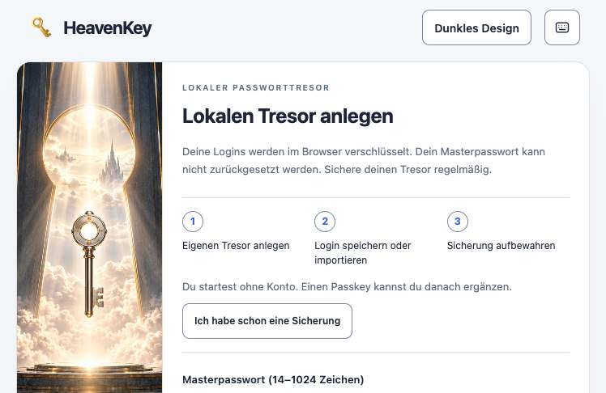
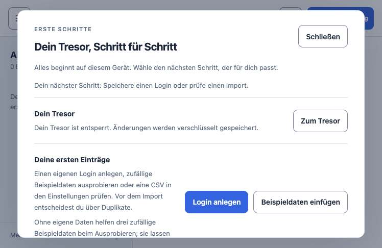
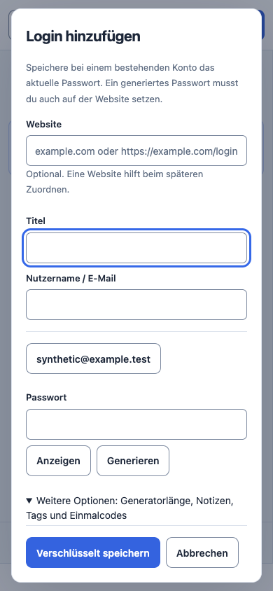

# HeavenKey 0.30.0: lokale Abnahme am 11. November 2026

Basis: `287041e` (`origin/main` beim Abruf). Alle Testdaten sind synthetisch.
Diese Abnahme umfasst den aktuellen lokalen Quellstand mit den Änderungen
an Sitzungsfristen, CSV-Import, Rust-SQLCipher-Binding und CSS-Auslieferung.
Der Bericht ist kein unabhängiges Sicherheitsaudit.

## Ergebnis

| Prüfung | Ergebnis | Beleg |
| --- | --- | --- |
| `UV_OFFLINE=1 CHROME_PATH=<Chrome for Testing> just check` | bestanden, 363,1 s | `docs/evidence/check.log`, `docs/evidence/commands.jsonl` |
| `CHROME_PATH=<Chrome for Testing> just e2e` | bestanden, 17,2 s | `docs/evidence/e2e.log`, `docs/evidence/e2e.json` |
| `just mobile-check` nach `flutter pub get --enforce-lockfile` | bestanden, 13,1 s | `docs/evidence/mobile-check.log` |
| Desktop-Onboarding, echter lokaler Rust-Tresor | bestanden | [Receipt](onboarding-v030-local/desktop-acceptance.json) |
| Chromium-Extension mit Feldschlüsseln, Rust und virtuellem Passkey | 64/64 bestanden | `apps/extension/TEST-RECEIPT.json` |
| Firefox-Extension, temporäres Profil und nativer Kontextmenüpfad | 8/8 bestanden | [Receipt](onboarding-v030-local/firefox-autofill.json) |
| Helium-Extension im isolierten Profil | nicht abgenommen | Navigation zur lokalen Passwortseite endet vor dem ersten Testfall mit `ERR_ABORTED` oder einem 10-s-Timeout |

Der Desktop-Test erfasst Anlage, ersten Login, ausdrückliche Passworterzeugung,
verschlüsselte Sicherung, Vorschläge, Tastatur/Fokus, Sperren, Persistenz und
ein 390-px-Layout. Die Firefox-Prüfung erfasst **nicht** die neuen Inline-Symbole.
Die Chromium-Fixture nutzt einen nur für den Test hinzugefügten
`localhost`-Hostzugriff; der native Berechtigungsdialog ist nicht automatisiert.

## APU und Bilder

APU/MK hat den lokalen Server auf `/passwords/` bedient. Vor dem Fix lieferte
die vom Haupt-CSS importierte `/passwords-protected.css` einen 404. Danach
liefert sie `200 text/css`; die Desktop-Route hat keinen Netzwerkfehler mehr.
Der selektive Rust-Test der Public-Host-Allowlist ist bestanden. Der
APU-Desktop-Audit meldet keine harten Fehler und neun Warnungen, darunter
SVG-interne Überlappungen und eine nicht zugeordnete doppelte ID. Diese
Heuristik-Warnungen sind kein Beleg für neun sichtbare Defekte. Ein statischer
HTML-Check fand keine doppelten IDs.

Moli zeigte Bedienelemente, lieferte für den Screenshot jedoch eine weiße
Fläche. Der visuelle Nachweis stammt daher von Helium; dessen *Extension-E2E*
bleibt getrennt davon fehlgeschlagen.

## Lokaler Benchmark

[Rohwerte und Protokoll](onboarding-v030-local/benchmark.json): ein Start eines
Debug-Binaries mit leerem Wegwerf-Tresor, anschließend 20 sequenzielle
Loopback-GETs je Route. Alle 80 Antworten waren HTTP 200.

| Route | Median | p95 |
| --- | ---: | ---: |
| `/health` | 0,80 ms | 1,18 ms |
| `/passwords/` | 0,60 ms | 0,81 ms |
| `/passwords.css` | 0,65 ms | 0,78 ms |
| `/passwords-protected.css` | 0,50 ms | 0,63 ms |

Die erste Health-Antwort kam nach 75,82 ms (ein Einzelwert). Das misst
weder Endnutzer-Latenz noch andere Plattformen, parallele Last oder
Zeitersparnis beim Onboarding. Es gibt keinen Vorher-nachher-Leistungsvergleich.
Die JSON-Datei bindet die Werte an den SHA-256 des getesteten Binaries und
der geänderten API-Quelle.

## Release-Grenzen

`v0.30.0-preview.1` existiert bereits. Eine weitere Vorschau braucht einen
neuen unveränderlichen Tag und die vollständige GitHub-Release-Pipeline:
öffentliche CI, Android-Vorschau, fünf Desktop-Ziele, zwei Extensions und
ein quellgebundenes Gesamtbundle. Lokale ZIPs allein sind keine
plattformübergreifende Abnahme. Der vorhandene Recovery-Stash und
ungetrackte PII-Broker-Arbeit dürfen nicht in den Release-Fingerprint geraten.

Hardware, echte Konten, dauerhafte Firefox-Signierung, macOS-Notarisierung
und Browser-Store-Freigaben bleiben offen. Nicht von einer bestehenden
Installation ohne geprüfte verschlüsselte Sicherung wechseln.
