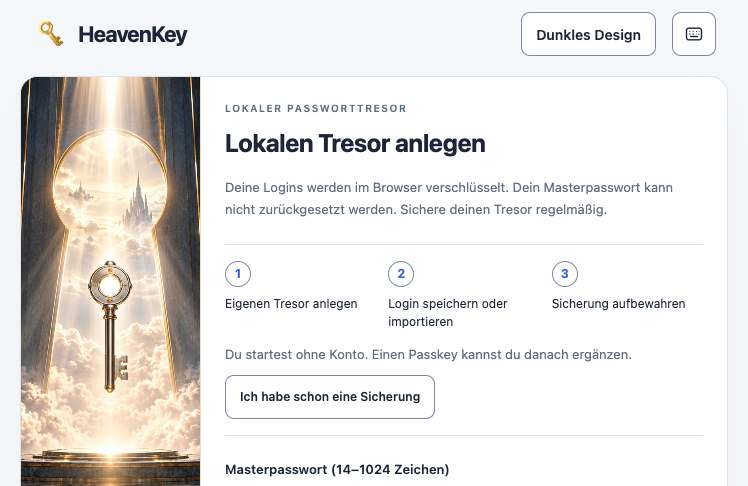
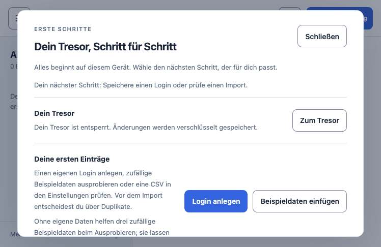
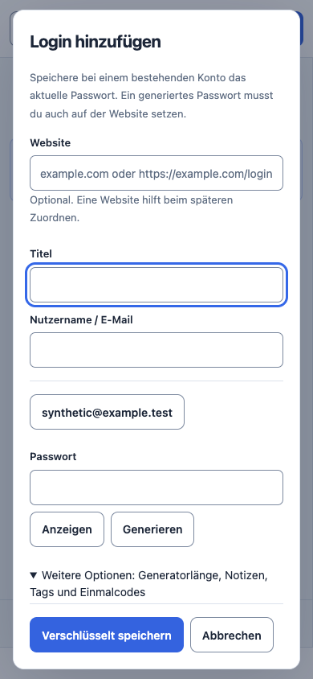

# HeavenKey 0.31: lokale Release-Abnahme

Stand: 11. November 2026, ausgehend von `d8e6ee2`. Alle Konten und Geräte-PINs
in dieser Abnahme sind synthetisch. Die Tests liefen vor dem 0.31-Commit;
deshalb binden die Receipts ihre Quellen und Binaries an SHA-256 statt an
einen noch nicht vorhandenen Release-Commit. Die GitHub-CI prüft den
committeten Stand nach dem Tag-Push erneut.

## Prüfergebnis

| Pfad | Ergebnis | Beleg |
| --- | --- | --- |
| `just check-fast` | bestanden, Rust-Format, TypeScript, gezielte Tests, Extension-Paket | [Gate-Verlauf](onboarding-v031-local/gates.json) |
| `just check` | bestanden, 424,8 s | [Gate-Verlauf](onboarding-v031-local/gates.json) |
| `just e2e` | 138/138, 17,2 s, virtuelle CTAP2-Geräte und echter Rust-Verifier | [Einzelfälle](onboarding-v031-local/e2e-current.json) |
| `just mobile-check` | bestanden, 30,1 s, Analyse, Flutter-Tests und native Policy | [Gate-Verlauf](onboarding-v031-local/gates.json) |
| Desktop-Erststart | bestanden: Tresor, Login, Sicherung, Sperre, Persistenz, Tastatur und 390-px-Ansicht | [Desktop-Receipt](onboarding-v031-local/desktop-acceptance.json) |
| Chromium-Extension | 64/64 mit Feldschlüsseln und realer Rust-Kopplung | [Extension-Receipt](onboarding-v031-local/chromium-extension.json) |
| Firefox-Extension | 8/8: Kopplung, Formular-Fill, Vorlage, Reload-Sperre | [Firefox-Receipt](onboarding-v031-local/firefox-autofill.json) |
| Android-16-Emulator, 0.31-ARM64-Release-APK | bestanden: Paket-Hash auf Gerät, Geräte-PIN, erster Login, genaue Herkunft, Generatorfreigabe, Vorschläge und Prozess-Neustart | [APK-Receipt](mobile/android-onboarding-031-preview-apk.json) |
| Android-16-Emulator, native Instrumentation | 4/4: Keystore/Passkey-Restore, Fehlerschutz, Profil-Backup und System-Autofill | [Native-Receipt](mobile/android-native-031-local.json), [Runner-Ausgabe](mobile/android-native-031-instrumentation.txt) |

Ein erster voller Check scheiterte an der 5-s-Frist eines Crypto-Sync-Tests,
während fremde Builds die Maschine auslasteten. Derselbe Test bestand
anschließend einzeln (5/5); der vollständige Check bestand danach ohne
Codeänderung. Dieser Fehlversuch bleibt im [Gate-Verlauf](onboarding-v031-local/gates.json).
Die Flutter-Abhängigkeiten wurden mit dem vorhandenen Lockfile aufgelöst.

Die Android-Release-APK meldet `0.31.0-preview`, VersionCode `2031`, minSdk 30
und die getrennte Paketkennung `app.heavenkey.heavenkey_mobile.preview`.
Sie ist für **Testdaten** mit einer Android-Debug-Identität signiert, nicht
mit einer dauerhaften Publisher-Identität. Die lokal ausgeführte ARM64-APK
ist nicht automatisch bytegleich mit den späteren CI-Artefakten.

## Oberfläche

APU/MK lud die 0.31-Passwortseite in Helium. Der Erststart ließ sich mit
synthetischem Masterpasswort bedienen, der Einrichtungsdialog öffnete sich,
und alle geladenen Ressourcen antworteten ohne HTTP-Fehler. Der
[APU-Audit](onboarding-v031-local/apu-helium-audit.json) meldete keine harten
Fehler, aber neun Hinweise, darunter SVG-Überlappungen und eine
nicht zugeordnete doppelte ID. Diese Heuristik ist keine Liste von neun
bestätigten sichtbaren Defekten.

Android-Screenshots bleiben durch `FLAG_SECURE` schwarz. Dieser Schutz wurde
für die Bildabnahme nicht abgeschaltet. Die Android-UI wurde stattdessen
über sichtbare Semantik-Elemente, echte Geräte-PIN und Persistenz geprüft.

## Messung

[Rohdaten und Grenzen](onboarding-v031-local/benchmark.json): ein
Debug-Binary, ein leerer Wegwerf-Tresor, ein Start und je 20 sequenzielle
Loopback-GETs; alle 80 antworteten mit HTTP 200. Median / p95:
`/health` 1,17 / 2,60 ms, `/passwords/` 0,90 / 1,01 ms,
`/passwords.css` 1,22 / 2,47 ms und `/passwords-protected.css`
2,38 / 17,39 ms. Die erste Health-Antwort kam nach 28,54 ms.
Die Maschine hatte wechselnde Last; das ist weder ein fairer Vergleich
mit 0.30 noch ein Nutzer-Latenz- oder Skalierungsbenchmark.

## Offene Grenzen

Firefox-Inline-Symbole wurden nicht separat geprüft. Der Helium-Extension-E2E
brach auf 0.30 vor dem ersten Fall bei der Navigation zur lokalen
Passwortseite ab und wurde auf 0.31 nicht als bestanden ausgegeben; die
0.31-Helium-Bilder beweisen nur die Desktop-Oberfläche. Physische Geräte,
native Windows-Abnahme, dauerhafte Android-Signatur, Browser-Store-Freigabe,
Apple-Notarisierung und ein unabhängiges Audit fehlen.

`v0.31.0-preview.1` soll nur veröffentlicht werden, wenn die GitHub-Pipeline
die öffentliche CI, Android-Vorschau, fünf Desktop-Ziele und das
quellgebundene Gesamtbundle besteht. Vor einem Wechsel von einer bestehenden
Installation eine verschlüsselte Sicherung erstellen und ihre
Wiederherstellung prüfen.
